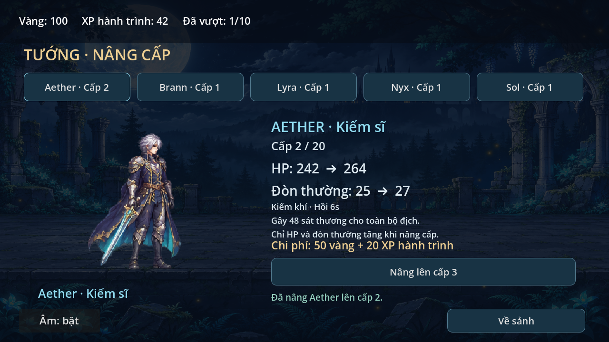
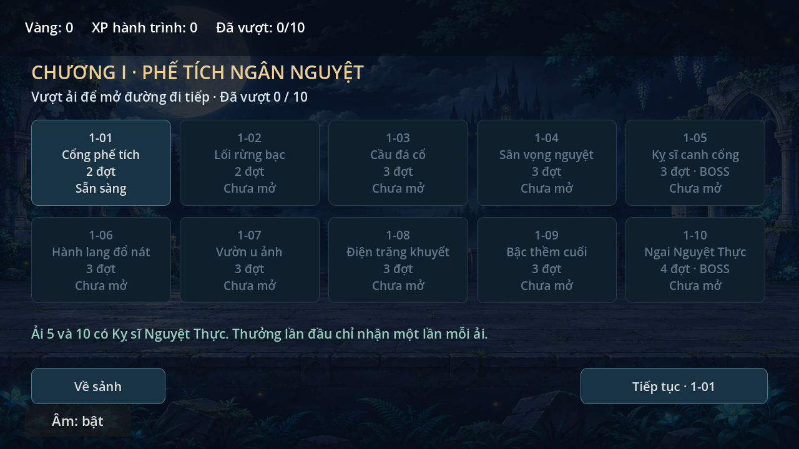
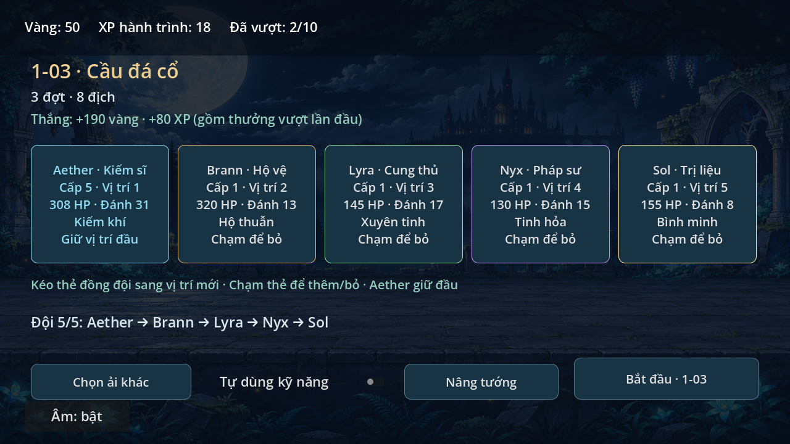
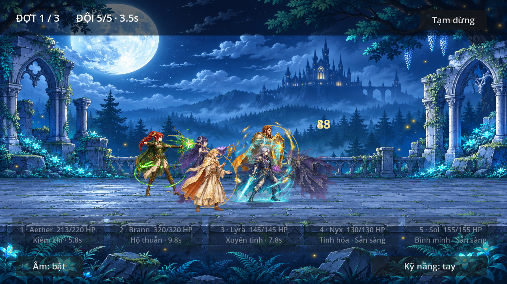

# Kiếm Hành — prototype 0.7.0

Game nhập vai đội hình nhìn ngang, tham khảo nhịp chơi Sword Master Story.
Đã có chương10ải, chuẩn bị đội1–5tướng, kỹ năng riêng/tự động, thưởng và lưu tiến trình local.
Bốn đồng đội Brann/Lyra/Nyx/Sol đã có sprite fantasy riêng và sáu trạng thái.
Kiếm sĩ Aether đã có sprite anime fantasy riêng và sáu trạng thái hoạt ảnh.
Hai loại quái và bối cảnh đã có hình fantasy riêng.

## Âm thanh · 0.7.0
Sảnh hoặc tạm dừng → **Âm lượng**: chỉnh tổng/hiệu ứng0–100%, bật/tắt,
bấm **Lưu** để áp dụng; **Hủy** giữ thiết lập cũ. Kỹ năng/đợt/kết quả được
ưu tiên khi nhiều âm phát cùng lúc; pause dừng âm đang phát. Phiên bản ởsảnh
đọc từ project.godot. [Chi tiết và giới hạn](docs/AUDIO.md).

## Trang bị · 0.6.2
Sảnh hoặc chuẩn bị → **Trang bị**. Mua6món bằng vàng, mặc/tháo vũ khí và giáp
cho5tướng; mỗi món một bản, tháo để đổi người dùng. Cộng HP/đòn thường sau cấp,
lưu ngay và áp dụng ở trận mới. Tự đọc save0.5/0.6, giữ bản sao trước chuyển đổi.
[Giá, cách thử, dữ liệu và giới hạn](docs/EQUIPMENT.md).

## Kéo thả đội hình · 0.6.1
Trong màn chuẩn bị, kéo thẻ đồng đội sang thẻ khác để đổi vị trí rồi thả để lưu.
Chạm nhanh để thêm/bỏ; Aether giữ vị trí đầu. Hỗ trợ cảm ứng và chuột.
[Hướng dẫn và ảnh kiểm tra](docs/PARTY_DRAG.md).

## Nâng tướng · 0.6.0
Sảnh hoặc màn chuẩn bị → **Nâng tướng**. Năm tướng cấp1–20, nâng bằng vàng+XP,
xem HP/đòn thường trước–sau và chi phí. Cấp lưu cùng tiến trình, áp dụng ở trận
kế tiếp. Tự đọc save0.5, giữ ải/ví/đội và bản sao dữ liệu cũ.
[Xem cách dùng, chi phí và chuyển save](docs/HERO_GROWTH.md).



## Chương I · 0.5.0
Sảnh → **Chọn ải** → chuẩn bị đội → chiến đấu → nhận thưởng → mở ải tiếp.
Boss ở1-05/1-10. Thưởng lần đầu tách thưởng chơi lại; đóng/mở game giữ tiến trình,
đội hình, vàng và XP hành trình. Vàng/XP dùng nâng tướng từ0.6.0; chưa có trang bị.
[Xem thông số, cách thử và lưu dữ liệu](docs/CAMPAIGN.md).




## Frame rời 0.4.3
Đã gỡ bản thử bộ xương. Năm tướng, hai loại quái và boss dùng168PNG độc lập,
không lấy ô256×256 khi render. Vào **Xem nhân vật · 5 tướng**, chọn trạng thái,
bấm **Frame trước / Frame sau** để dừng xem từng hình, **Phát lại** để chạy tiếp.
[Chi tiết và ảnh kiểm tra](docs/SPRITE_FRAMES.md).

## Bốn đồng đội 0.4.1
Đã thay hình tạm bằng sprite Brann, Lyra, Nyx và Sol. Sảnh → **Xem nhân vật · 5 tướng**
để đổi tướng và thử sáu trạng thái. [Chi tiết, nguồn và ảnh thật](docs/PARTY_ART.md).



## Đội hình 0.4.0
Mặc định năm tướng: Aether, Brann, Lyra, Nyx và Sol. Chọn số tướng 1–5 ở sảnh;
chạm thẻ kỹ năng hoặc phím 1–5 trong trận. Có bật/tắt tự động dùng kỹ năng,
hộ thuẫn toàn đội và hồi máu. Chỉ thua khi cả đội gục.
[Thông số, cách thử và giới hạn](docs/PARTY.md).

## Boss đầu tiên 0.3.3
Sau ba đợt quái, đối đầu **Kỵ sĩ Nguyệt Thực**: ba đòn, hai giai đoạn,
thanh máu và hình riêng. Kỹ năng luôn gây sát thương bình thường, không cần canh sơ hở.
[Xem cơ chế và cách thử](docs/BOSS.md).


## Sửa nền mờ 0.3.2
Lọc pixel nền bán trong suốt còn sót trong sprite Aether và quái khi render,
giảm khung chữ nhật mờ quanh nhân vật. Giữ ảnh gốc và cách chơi.

## Cảnh chiến đấu mới 0.3.1
Kỵ sĩ Hắc giáp và Pháp sư U ảnh có hoạt ảnh di chuyển/đánh, phản hồi trúng đòn
và tan biến. Nền Phế tích Ngân Nguyệt thay nền hình học cũ; cách chơi giữ nguyên.


[Chi tiết nguồn và giới hạn](docs/ENVIRONMENT_AND_ENEMIES.md).

## Nhân vật mới 0.3.0
Vào **Xem nhân vật · Aether** ở sảnh để xem lớn và thử sáu trạng thái.
Nhân vật tóc bạc/giáp bạc viền vàng/áo choàng xanh đêm đã thay hình tạm trong trận.
[Xem nguồn, cách tích hợp và giới hạn](docs/CHARACTER_AETHER.md).

## Chơi thử
Godot4.6.3, renderer Compatibility. Import project.godot, đợi import, Run.
Màn hình ngang1280×720logical, canvas co theo màn hình.
- Chọn ải đã mở, thêm/bớt/đổi thứ tự đồng đội ở màn chuẩn bị; Aether giữ đầu.
- Tướng tự chạy/đánh; chạm thẻ kỹ năng hoặc phím1–5, Space dùng Kiếm khí.
- Có bật/tắt tự động dùng skill; lựa chọn lưu cùng profile.
- Tạm dừng/Esc; chuyển ứng dụng tự pause, quay lại bấm Tiếp tục.
- Thắng mở ải tiếp và cộng thưởng, chơi lại nhận thưởng trận; thua/bỏ không mất ví.
- Đóng/mở lại giữ các ải đã vượt và tài nguyên; trận đang đánh phải chơi lại.
- Sảnh hoặc chuẩn bị → Nâng tướng; chi phí và chỉ số mới hiện rõ, lưu ngay khi nâng.
- Âm bật/tắt lưu riêng; không APK hoặc đồng bộ cloud.

## Cập nhật trên S23 Ultra
Giữ SSH hiện có. Repo này có thư mục riêng, không ghi đè Game-2.5D.
Lần đầu trong Termux (đã cài git, openssh, rsync và cấp quyền storage):

```sh
mkdir -p ~/repos
git clone git@github.com:tai23082004l02-svg/Sword-master-story.git ~/repos/Sword-master-story
mkdir -p /storage/emulated/0/Download/GodotProjects/Sword-master-story
```

Lưu và đóng Godot trước mỗi lần cập nhật:

```sh
git -C ~/repos/Sword-master-story status
git -C ~/repos/Sword-master-story pull --ff-only
rsync -rc --backup --backup-dir="$HOME/sword-backup-before-sync" --exclude='.git/' --exclude='.godot/' "$HOME/repos/Sword-master-story/" /storage/emulated/0/Download/GodotProjects/Sword-master-story/
```

Nếu pull báo thay đổi local, giữ file và xử lý; không reset --hard.
Import project.godot ở thư mục mới. Không cần ZIP hoặc APK.

## Kiểm tra phát triển

```sh
godot --headless --path . --editor --import --quit
XDG_DATA_HOME=/tmp/sword-test godot --headless --path . --script tests/audio_smoke.gd
XDG_DATA_HOME=/tmp/sword-test godot --headless --path . --script tests/audio_scene_smoke.gd
XDG_DATA_HOME=/tmp/sword-test godot --headless --path . --script tests/equipment_smoke.gd
XDG_DATA_HOME=/tmp/sword-test godot --headless --path . --script tests/equipment_scene_smoke.gd
XDG_DATA_HOME=/tmp/sword-test godot --headless --path . --script tests/growth_smoke.gd
XDG_DATA_HOME=/tmp/sword-test godot --headless --path . --script tests/growth_scene_smoke.gd
XDG_DATA_HOME=/tmp/sword-test godot --headless --path . --script tests/campaign_smoke.gd
XDG_DATA_HOME=/tmp/sword-test godot --headless --path . --script tests/campaign_save_smoke.gd
XDG_DATA_HOME=/tmp/sword-test godot --headless --path . --script tests/campaign_scene_smoke.gd
XDG_DATA_HOME=/tmp/sword-test godot --headless --path . --script tests/battle_smoke.gd
XDG_DATA_HOME=/tmp/sword-test godot --headless --path . --script tests/scene_smoke.gd
XDG_DATA_HOME=/tmp/sword-test godot --headless --path . --script tests/party_smoke.gd
XDG_DATA_HOME=/tmp/sword-test godot --headless --path . --script tests/party_scene_smoke.gd
XDG_DATA_HOME=/tmp/sword-test godot --headless --path . --script tests/companion_art_smoke.gd
```

Xem [thiết kế](docs/GAME_DESIGN.md), [lộ trình](docs/ROADMAP.md),
[âm thanh](docs/AUDIO.md), [bàn giao](docs/HANDOFF.md), [kiểm tra](docs/TEST_RESULTS.md).
