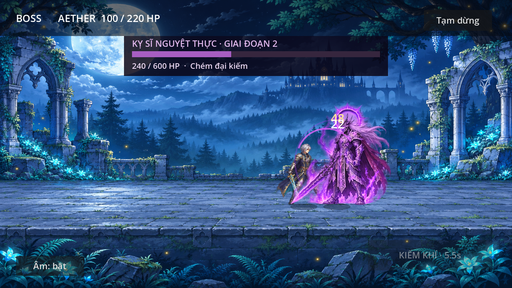
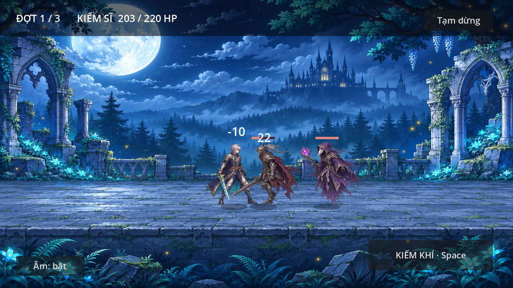

# Kiếm Hành — prototype 0.4.0

Game nhập vai đội hình nhìn ngang, tham khảo nhịp chơi Sword Master Story.
Đã có nền chiến đấu đội tối đa năm tướng, kỹ năng riêng và chế độ tự động.
Bốn đồng đội mới dùng hình học tạm; chưa phải bản mỹ thuật hoàn thiện.
Kiếm sĩ Aether đã có sprite anime fantasy riêng và sáu trạng thái hoạt ảnh.
Hai loại quái và bối cảnh đã có hình fantasy riêng.

## Đội hình 0.4.0
Mặc định năm tướng: Aether, Brann, Lyra, Nyx và Sol. Chọn số tướng 1–5 ở sảnh;
chạm thẻ kỹ năng hoặc phím 1–5 trong trận. Có bật/tắt tự động dùng kỹ năng,
hộ thuẫn toàn đội và hồi máu. Chỉ thua khi cả đội gục.
[Thông số, cách thử và giới hạn](docs/PARTY.md).

## Boss đầu tiên 0.3.3
Sau ba đợt quái, đối đầu **Kỵ sĩ Nguyệt Thực**: ba đòn, hai giai đoạn,
thanh máu và hình riêng. Kỹ năng luôn gây sát thương bình thường, không cần canh sơ hở.
[Xem cơ chế và cách thử](docs/BOSS.md).



## Sửa nền mờ 0.3.2
Lọc pixel nền bán trong suốt còn sót trong sprite Aether và quái khi render,
giảm khung chữ nhật mờ quanh nhân vật. Giữ ảnh gốc và cách chơi.

## Cảnh chiến đấu mới 0.3.1
Kỵ sĩ Hắc giáp và Pháp sư U ảnh có hoạt ảnh di chuyển/đánh, phản hồi trúng đòn
và tan biến. Nền Phế tích Ngân Nguyệt thay nền hình học cũ; cách chơi giữ nguyên.



[Chi tiết nguồn và giới hạn](docs/ENVIRONMENT_AND_ENEMIES.md).

## Nhân vật mới 0.3.0
Vào **Xem nhân vật · Aether** ở sảnh để xem lớn và thử sáu trạng thái.
Nhân vật tóc bạc/giáp bạc viền vàng/áo choàng xanh đêm đã thay hình tạm trong trận.
[Xem nguồn, cách tích hợp và giới hạn](docs/CHARACTER_AETHER.md).

## Chơi thử
Godot 4.6.3, renderer Compatibility. Import `project.godot`, đợi import, Run.
Màn hình ngang 1280×720 logical, canvas co theo màn hình.
- Bấm Bắt đầu; cả đội tự chạy tới địch và đánh.
- Chạm thẻ kỹ năng hoặc phím 1–5; Space dùng Kiếm khí. Có chế độ tự động.
- Ba đợt gồm2/3/4quái cận chiến và đánh xa, sau đó boss600HP.
- Tạm dừng hoặc Esc; chuyển ứng dụng tự pause, quay lại bấm Tiếp tục.
- Có thắng/thua, chơi lại, về sảnh khi pause và bật/tắt âm lưu riêng.
- Chưa có thưởng, save tiến trình, trang bị, nhạc hoặc APK.

## Cập nhật trên S23 Ultra
Giữ SSH hiện có. Repo này có thư mục riêng, không ghi đè Game-2.5D.
Lần đầu trong Termux (đã cài git, openssh, rsync và cấp quyền storage):

```sh
mkdir -p ~/repos
git clone git@github.com:tai23082004l02-svg/Sword-master-story.git ~/repos/Sword-master-story
mkdir -p /storage/emulated/0/Download/GodotProjects/Sword-master-story
```

Lưu và đóng Godot trước mỗi lần cập nhật:

```sh
git -C ~/repos/Sword-master-story status
git -C ~/repos/Sword-master-story pull --ff-only
rsync -rc --backup --backup-dir="$HOME/sword-backup-before-sync" --exclude='.git/' --exclude='.godot/' "$HOME/repos/Sword-master-story/" /storage/emulated/0/Download/GodotProjects/Sword-master-story/
```

Nếu pull báo thay đổi local, giữ file và xử lý; không reset --hard.
Import project.godot ở thư mục mới. Không cần ZIP hoặc APK.

## Kiểm tra phát triển

```sh
godot --headless --path . --editor --import
XDG_DATA_HOME=/tmp/sword-test godot --headless --path . --script tests/battle_smoke.gd
XDG_DATA_HOME=/tmp/sword-test godot --headless --path . --script tests/scene_smoke.gd
XDG_DATA_HOME=/tmp/sword-test godot --headless --path . --script tests/party_smoke.gd
XDG_DATA_HOME=/tmp/sword-test godot --headless --path . --script tests/party_scene_smoke.gd
```

Xem [thiết kế](docs/GAME_DESIGN.md), [lộ trình](docs/ROADMAP.md),
[âm thanh](docs/AUDIO.md), [bàn giao](docs/HANDOFF.md), [kiểm tra](docs/TEST_RESULTS.md).
