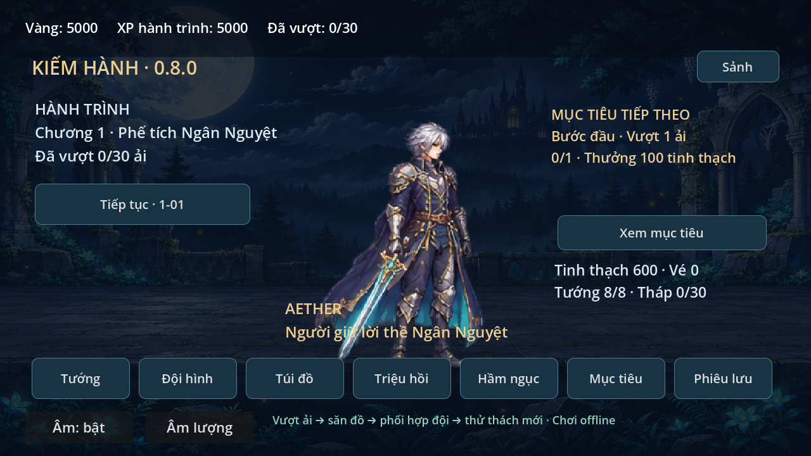
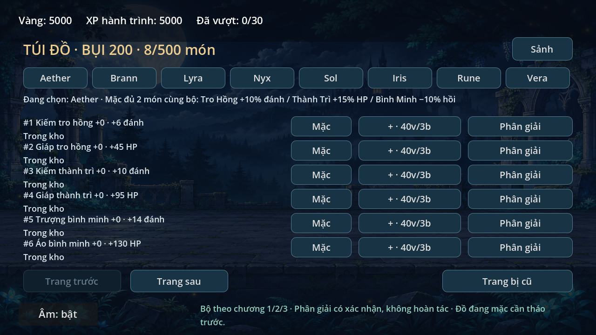

# Kiếm Hành — prototype 0.8.1

RPG đội hình fantasy nhìn ngang, Godot 4.6.3 Compatibility, tiếng Việt, offline.
Vòng chơi: **vượt ải → nhận trang bị → xây đội → vượt thử thách mới**.
Tài nguyên/hình/nhân vật riêng, không dùng asset Sword Master Story.

## Rà soát 0.8.1
Đã kiểm tra toàn bộ phạm vi RPG, sửa hiển thị thưởng hầm/tháp, giữ vòng tuần
của thử thách từ lúc bắt đầu và giữ trạng thái khi lưu thất bại.
[Báo cáo tiến độ và giới hạn](docs/RPG_REVIEW.md).

## Chơi bản mới
- **Sảnh:** nhân vật đại diện, mục tiêu tiếp theo và lối vào các hệ thống.
- **Phiêu lưu:** ba chương, 30 ải, boss mỗi năm ải; chương mới có địch giáp,
  hồi máu và sát thủ, boss đánh toàn đội/truy kích tuyến sau.
- **Tướng:** năm tướng cũ và Iris/Rune/Vera mở bằng mảnh. Xem nội tại, nâng
  cấp/kỹ năng/bậc; thử tướng chưa có trong trận không thưởng.
- **Đội hình:** Aether cùng tối đa bốn đồng đội; kéo thả để đổi thứ tự.
- **Túi đồ:** từng món riêng, mặc/tháo, cường hóa +10, phân giải có xác nhận.
  Mỗi chương một bộ hai món; thắng luôn có đồ, luân phiên để kiếm đủ bộ.
- **Hầm ngục:** mở sau 1-05, gồm vàng, nguyên liệu, tháp 30 tầng và thử thách tuần.
- **Triệu hồi:** vé/tinh thạch kiếm trong game, hiển thị tỉ lệ, mảnh và bảo đảm
  ở lượt 20. Không nạp tiền. Vé quét là tài nguyên riêng, kiếm qua thắng đánh tay.
- **Mục tiêu:** thưởng hành trình, thưởng tuần và thống kê hoạt động chỉ trên máy.
- **Âm lượng:** chỉnh tổng/SFX ở sảnh hoặc pause; không có API lúc chơi.




Mở project.godot, chờ import rồi Run. Tướng tự chạy/đánh; chạm thẻ kỹ năng
hoặc phím 1–5; Space dùng kỹ năng Aether. Có tự dùng kỹ năng, tạm dừng/Esc,
mất focus tự pause. Trận ngắt phải chơi lại, không mất ví vì thua.

[Luật, giá, tỉ lệ, cách thử và giới hạn](docs/RPG_SYSTEMS.md).
Ba tướng mới dùng hình biến thể từ bộ riêng cũ, chưa có tranh độc lập.
Nền/quái/boss tái sử dụng hình cũ với màu và cơ chế mới. Chưa thử S23/cảm ứng
thật hoặc chứng minh giữ chân. Chưa APK, server, PvP hay bang hội.

## Giữ tiến trình cũ
Save schema 4 tự đọc 1/2/3, giữ ví/ải/đội/cấp/trang bị cũ. Không ghi khi chỉ load;
lần ghi mới giữ backup migration theo schema nguồn. Đồ cũ nằm ở **Trang bị cũ**
trong Túi đồ; một ô không cộng đồng thời món mới và món cũ. Không đổi project name
hoặc vị trí audio.cfg. Bản game cũ không đọc được save mới.

## Cập nhật trên S23 Ultra
Giữ SSH hiện có. Repo này có thư mục riêng, không ghi đè Game-2.5D.
Lần đầu trong Termux (đã cài git, openssh, rsync và cấp quyền storage):

```sh
mkdir -p ~/repos
git clone git@github.com:tai23082004l02-svg/Sword-master-story.git ~/repos/Sword-master-story
mkdir -p /storage/emulated/0/Download/GodotProjects/Sword-master-story
```

Lưu và đóng Godot trước mỗi lần cập nhật:

```sh
git -C ~/repos/Sword-master-story status
git -C ~/repos/Sword-master-story pull --ff-only
rsync -rc --backup --backup-dir="$HOME/sword-backup-before-sync" --exclude='.git/' --exclude='.godot/' "$HOME/repos/Sword-master-story/" /storage/emulated/0/Download/GodotProjects/Sword-master-story/
```

Nếu pull báo thay đổi local, giữ file và xử lý; không reset --hard.
Import project.godot ở thư mục mới. Không cần ZIP hoặc APK.

## Kiểm tra phát triển

```sh
godot --headless --path . --editor --import --quit
XDG_DATA_HOME=/tmp/sword-test godot --headless --path . --script tests/rpg_progress_smoke.gd
XDG_DATA_HOME=/tmp/sword-test godot --headless --path . --script tests/rpg_scene_smoke.gd
XDG_DATA_HOME=/tmp/sword-test godot --headless --path . --script tests/rpg_tactics_smoke.gd
```

Chạy toàn bộ tests/*smoke.gd với save thử riêng cho hồi quy. Capture UI bằng
 tests/capture_rpg.gd cần display/OpenGL, không chạy headless để lấy ảnh.
Xem [bàn giao](docs/HANDOFF.md), [kiểm tra](docs/TEST_RESULTS.md),
[lộ trình](docs/ROADMAP.md), [âm thanh](docs/AUDIO.md).
