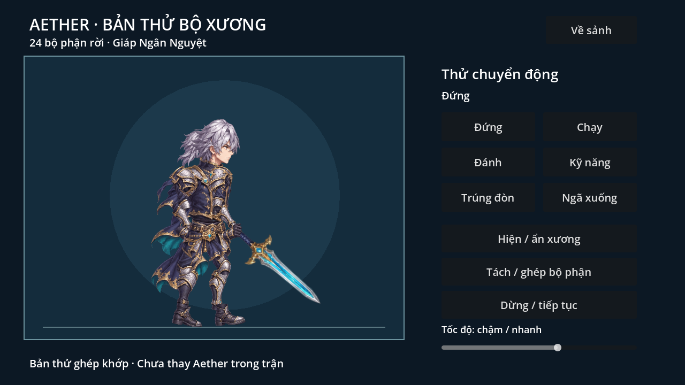
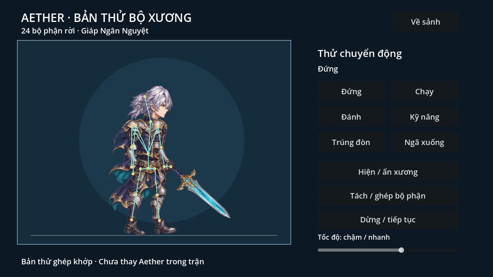
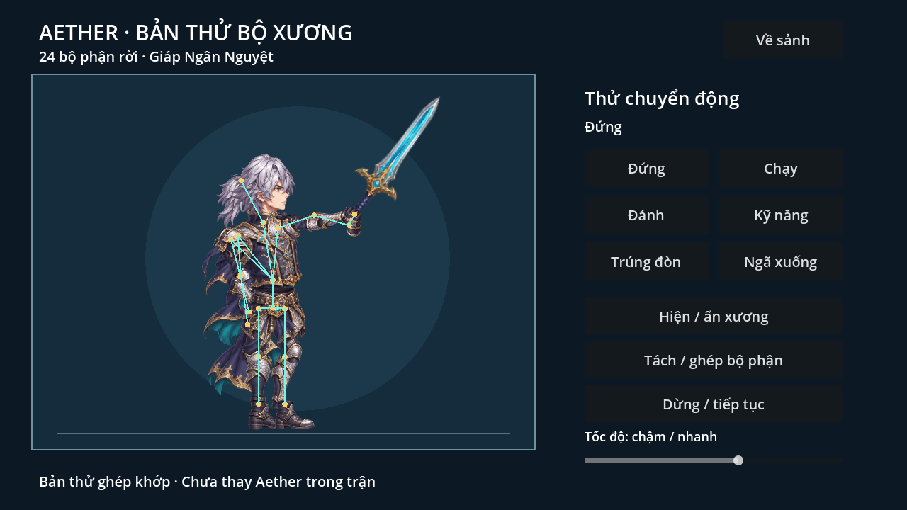
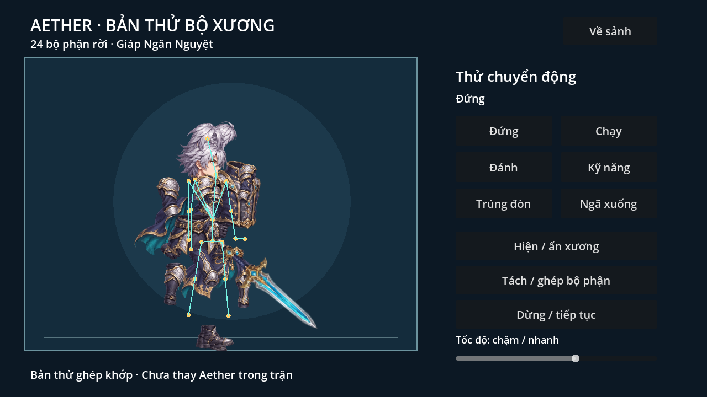

# Aether — thử bộ xương 0.4.2

## Mở bản thử
Cập nhật repo rồi vào sảnh → **Thử Aether · bộ xương** (góc dưới phải).
Có sáu động tác đứng/chạy/đánh/kỹ năng/trúng đòn/ngã, dừng/tiếp tục,
chỉnh tốc độ0.25–1.5, hiện xương và tách/ghép bộ phận. **Về sảnh** quay lại game.
Bản thử chuẩn bị hình/khớp riêng; chưa thay Aether trong trận, chưa chuyển bốn
đồng đội. Trận và chỉ số, save/âm thanh vẫn theo0.4.1.

## 24 PNG rời
Trong `assets/aether_rig/parts/`:
- torso, pelvis, belt: thân, hông, đai/tà eo;
- head, hair_back, hair_front: đầu và hai lớp tóc;
- cape_upper, cape_middle, cape_lower: ba đoạn áo choàng;
- arm_front_upper/lower, hand_front, pauldron_front: tay/giáp vai trước;
- arm_back_upper/lower, hand_back, pauldron_back: tay/giáp vai sau;
- leg_front_upper/lower, boot_front: đùi/cẳng chân/giày trước;
- leg_back_upper/lower, boot_back: đùi/cẳng chân/giày sau;
- sword: kiếm riêng, nối với bàn tay trước.

Mỗi file chỉ có một bộ phận, alpha trong suốt, giữ phần khớp để lớp kế tiếp
chồng lên. Không còn lấy ô động tác từ sheet khi chạy bản rig.
Nguồn gốc, vùng ảnh gốc và tên file trong `manifest.json`. Giữ ảnh kit gốc ở
`source_parts.png` để đối chiếu, không dùng nó làm atlas runtime.

## Chỉnh trong Godot
Mở `scenes/aether_rig.tscn`: Skeleton2D,20Bone2D,24Sprite2D và AnimationPlayer.
Các node đã lưu trong scene và có owner để sửa trực tiếp trong editor.
Tay: vai→cẳng tay→bàn tay→kiếm; chân: đùi→cẳng chân→bàn chân;
root hông→thân→cổ, thêm nhánh tóc và áo choàng. Điểm xoay là vị trí Bone2D;
Sprite2D có offset/scale/z riêng. Sáu clip có track rotation cho toàn bộ xương
và track position cho hông, reset tư thế khi đổi clip. Death giữ cuối, các clip
khác loop để kiểm khớp. Nút tách hình chỉ phục vụ kiểm tra và ghép lại được.

`game/aether_rig.gd` chứa cách dựng và điều khiển. Chạy
`tools/build_aether_rig.gd` sẽ **ghi lại scene từ cấu hình trong code**; nếu đã
chỉnh scene bằng tay, lưu bản sao trước hoặc cập nhật code dựng tương ứng.
Lab ở `scenes/aether_rig_lab.tscn`, giao diện tiếng Việt, không dùng dịch vụ mới.

## Nguồn, giới hạn và bước sau
Bộ phận được tạo mới bằng OpenAI image generation ngày2026-11-06, lấy Aether
hiện có làm tham chiếu thiết kế. Không dùng hình/nhân vật/code game khác,
không gán nhãn vẽ tay/CC0. Godot tách24vùng, áp bộ lọc alpha0.3.2 đúng một lần
và trim viền trong suốt bằng `tools/extract_aether_parts.gd`. Không repaint bằng
script; PNG riêng được lưu vào repo để máy người dùng không cần chạy công cụ.

Đây là **rig cutout cứng theo xương**, chưa có mesh skin/biến dạng vải, IK hay
bộ động tác chiến đấu cuối. Hình mới có thể khác tỷ lệ/chi tiết Aether cũ; phần
giáp chồng khớp và áo choàng ba đoạn cần người dùng duyệt ở các góc động tác.
Nếu muốn động tác mềm hơn, bước kế là tinh chỉnh pivot/keyframe và mesh cho
áo choàng/tóc, rồi mới nối rig đã duyệt vào battle model. Không tự động suy ra
rig từ sheet động tác cũ, không đưa phần tách frame đang làm dở vào bản này.

## Kiểm tra
Godot4.6.3: aether_rig_smoke kiểm24texture/20bone có owner,6clip, chuyển động
pixel theo xương, pause, tách/ghép và mở lab. aether_rig_navigation kiểm từ sảnh
vào lab và quay về. Chụp/xem ảnh thực bằng OpenGL Compatibility/Mesa llvmpipe,
audio Dummy. Chưa thử S23 Ultra, chưa đo FPS/nhiệt hoặc nghe duyệt âm thanh.
