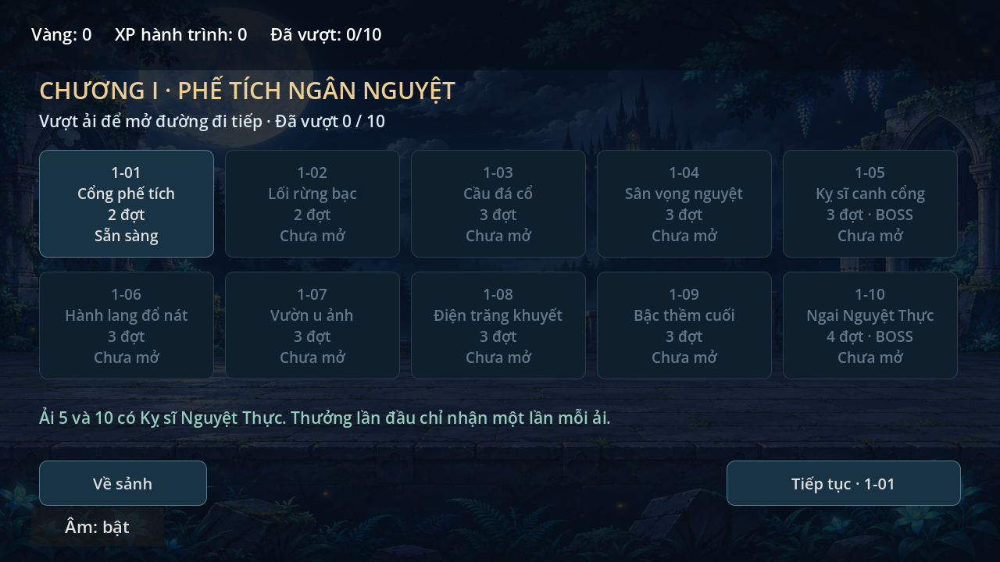
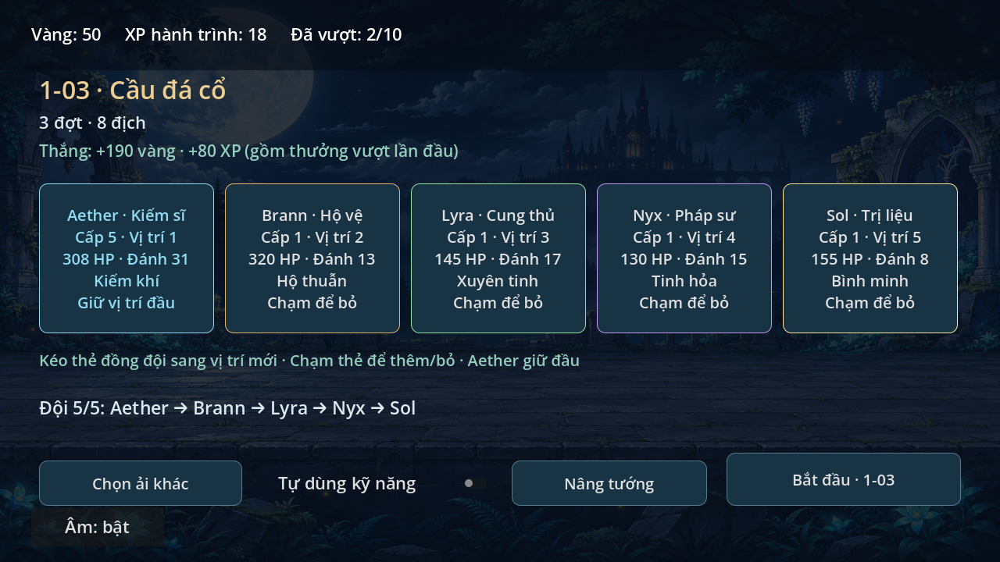
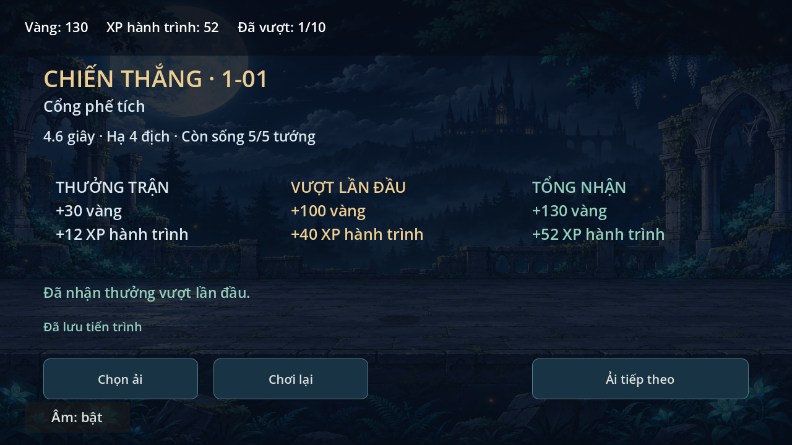
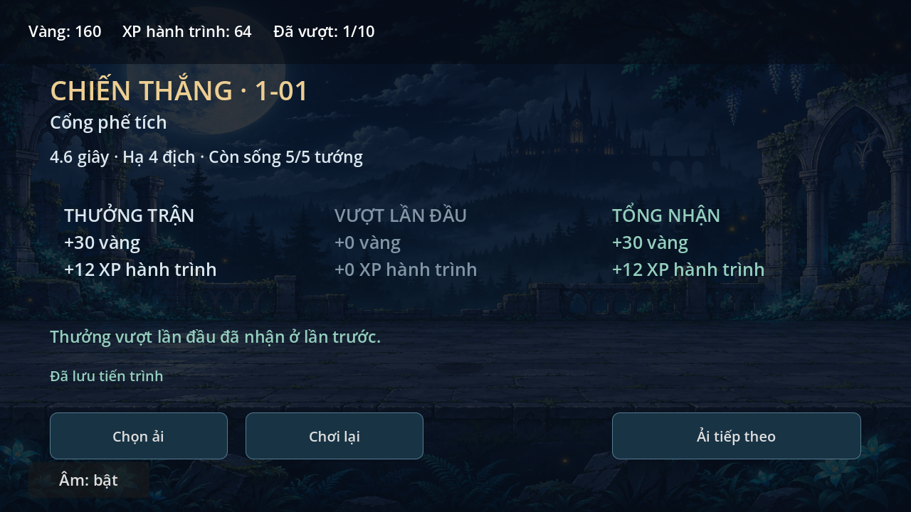
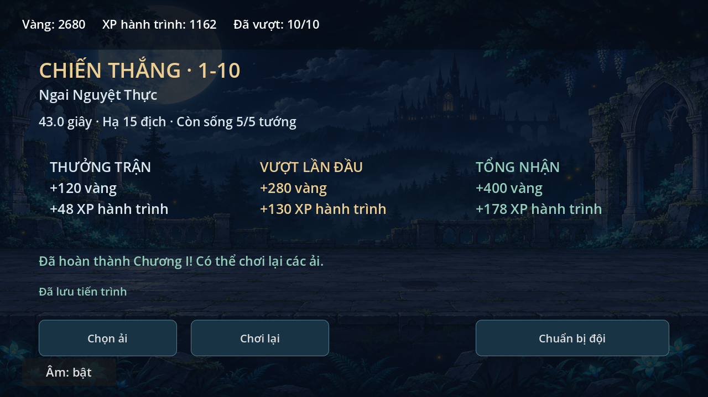

# Chương I — Phế tích Ngân Nguyệt · 0.5.0

## Chơi và tiếp tục
Sảnh → **Chọn ải** → chọn ải đã mở → chuẩn bị đội → **Bắt đầu**.
Chỉ 1-01 mở từ đầu; thắng mở ải tiếp theo. Hoàn thành1-10 kết thúc chương,
vẫn chơi lại được tất cả ải. Không có phí vào ải hoặc năng lượng ở bản này.

Màn chuẩn bị cho bỏ/thêm bốn đồng đội bằng thẻ và kéo thả thẻ để đổi thứ tự. Aether luôn ở vị trí đầu; đội1–5tướng. Tên, vai trò, HP, đánh thường và
kỹ năng hiện trên thẻ. Thứ tự thẻ kỹ năng trong trận khớp đội đã chọn, art và
auto skill chọn theo ID tướng, không theo vị trí cứng. Lựa chọn đội và tự dùng
kỹ năng lưu ngay khi đổi. Âm thanh/mute tiếp tục dùng audio.cfg cũ.

Thắng nhận thưởng trận + thưởng vượt lần đầu nếu chưa vượt ải đó. Chơi lại
chỉ nhận thưởng trận; thua hoặc về sảnh khi đang đánh không nhận thưởng và
không mất vàng/XP. Kết quả hiện thời gian, số địch hạ, tướng sống, ba cột thưởng
và nút ải tiếp theo/chơi lại/chọn ải. Vượt ải cuối có thông báo hoàn thành chương.

Đóng rồi mở game vẫn giữ ải đã vượt, vàng, XP, kỷ lục thời gian và đội hình.
**Trận đang đánh không được tiếp tục giữa chừng**; mở lại chọn ải để đánh lại,
không tự nhận thưởng cho trận bị ngắt. Thắng/thua được chốt lưu ngay khi model
kết thúc, trước khoảng chờ hoạt ảnh0.85s. Kết quả chỉ ghi “Đã lưu tiến trình”
khi commit thành công; nếu lỗi lưu, có nút thử lại và chưa cộng thưởng. Có thể
chọn **Về sảnh · bỏ kết quả** để thoát màn lỗi mà không nhận thưởng trận đó.

## Nội dung và chỉ số thử
| Ải | Tên | Địch từng đợt | HP quái đợt đầu | Hệ số sát thương địch | Vàng/XP trận | Vàng/XP lần đầu thêm |
| --- | --- | --- | ---: | ---: | --- | --- |
| 1-01 | Cổng phế tích | 2 / 2 | 50 | 0.70 | 30 / 12 | 100 / 40 |
| 1-02 | Lối rừng bạc | 2 / 3 | 62 | 0.80 | 40 / 16 | 120 / 50 |
| 1-03 | Cầu đá cổ | 2 / 3 / 3 | 74 | 0.90 | 50 / 20 | 140 / 60 |
| 1-04 | Sân vọng nguyệt | 3 / 3 / 4 | 86 | 1.00 | 60 / 24 | 160 / 70 |
| 1-05 | Kỵ sĩ canh cổng | 3 / 3 / boss750HP | 95 | 1.05 | 70 / 28 | 180 / 80 |
| 1-06 | Hành lang đổ nát | 3 / 4 / 4 | 108 | 1.10 | 80 / 32 | 200 / 90 |
| 1-07 | Vườn u ảnh | 4 / 4 / 4 | 122 | 1.15 | 90 / 36 | 220 / 100 |
| 1-08 | Điện trăng khuyết | 4 / 4 / 5 | 138 | 1.20 | 100 / 40 | 240 / 110 |
| 1-09 | Bậc thềm cuối | 4 / 5 / 5 | 154 | 1.30 | 110 / 44 | 260 / 120 |
| 1-10 | Ngai Nguyệt Thực | 4 / 5 / 5 / boss1500HP | 170 | 1.45 | 120 / 48 | 280 / 130 |

HP quái tăng6mỗi đợt trong cùng ải. 1-01 chỉ cận chiến; từ1-02 có cận chiến và
đánh xa theo cấu hình. Boss dùng hình/cơ chế cũ, đổi phase50%, không sơ hở hay
multiplier nhận damage. Địch cơ sở vẫn10/7, boss9/12/17(+2phase2), nhân hệ số
của ải. Chỉ số cơ sở/kỹ năng tướng giữ nguyên0.4.3;0.6.0 có nâng HP/đòn thường; Aether skill48không đổi theo phase.
Vượt đủ10ải lần đầu được tổng2650vàng/1150XP; chơi lại cộng thưởng trận tương ứng.

Vàng và XP hành trình **từ0.6.0 dùng để nâng tướng**, xem [HERO_GROWTH.md](HERO_GROWTH.md).
Không tự tăng chỉ số chỉ vì nhận XP; chưa có trang bị. Chưa có thêm hai loại
quái, nền/nhân vật mới, cốt truyện hội thoại, phó bản phụ hoặc chươngII.

## Lưu dữ liệu
Profile riêng tại `user://campaign.json`, schema2 từ0.6.0 (đọc save1 cũ); audio.cfg không bị thay thế.
Có cleared/records, wallet, formation, auto_skills, serial/last_claimed/pending và
hero_levels. Xem HERO_GROWTH.md cho chuyển save và bản.v1.bak.
Mỗi trận được cấp token tăng dần đã lưu trước khi bắt đầu; chỉ pending token
hiện tại được chốt một lần. Tất cả thưởng, mở ải và kỷ lục cùng commit, không
cộng từng phần trước khi ghi. Tải lại JSON chuẩn hóa số nguyên để không nhầm
ID tướng/ải thành số thực rồi cấp lại thưởng đầu.

Ghi tạm→flush→đọc/kiểm schema và nội dung→sao lưu bản chính hợp lệ→rename.
`campaign.json.bak` là lần lưu hợp lệ trước; nếu chính hỏng thì đọc backup và
thông báo đã mở bản dự phòng. Có thể mất tiến trình sau lần backup đó. Lần ghi
sau giữ bản chính hỏng thành `.damaged-*` để đối chiếu, không chép hỏng đè backup.
Nếu cả hai hỏng hoặc schema mới hơn không hỗ trợ, khóa ghi và giữ nguyên file;
không tự reset về game mới. Sảnh có nút thử tải lại tiến trình.

Đây là save **local**, không cloud/server/đồng bộ giữa máy hoặc chống sửa save.
Giữ bản sao campaign.json/.bak khi đổi máy hoặc trước gỡ ứng dụng. Đóng Godot
trước khi pull/rsync theo README; không reset --hard hoặc xóa thư mục user data.

## Cấu trúc
- campaign_data.gd:10ải, waves, tuning và bảng thưởng riêng của dự án.
- campaign_progress.gd:kiểm schema, normalize, transaction, backup và token.
- campaign_ui.gd:màn chọn/chuẩn bị/kết quả; không tự tính hoặc cộng tiền.
- battle.gd:nhận snapshot đội/ải; wave_limit, quái/boss theo data. API start()
  không tham số vẫn giữ trận3đợt+boss600HP cho hồi quy, không tính thưởng campaign.
- main.gd:điều phối flow, chốt kết quả ngay khi kết thúc, bind art/auto theoID.

Không chép code/công thức/bảng thưởng/tài nguyên APK tham khảo vào dự án.
Chỉ tham khảo nguyên tắc tách module, dữ liệu và trình bày; các file trên viết
riêng, chạy offline, không API runtime/dịch vụ/chi phí mới.

## Kiểm tra và giới hạn
campaign_smoke mô phỏng cả10ải ở60Hz với đội5đảo thứ tự và dùng skill khi hồi;
cả10thắng, boss chỉ5/10. campaign_save_smoke kiểm first/repeat, token trùng,
lost/abandon, mở lại/chơi lại sau mở, tổng ví, lỗi ghi/retry, backup/corrupt/future.
campaign_scene_smoke kiểm bấm flow thực, khóa ải, chọn/đổi đội, đúng artID,
auto/pause, lưu trước delay kết quả, thua/bỏ trận, reload và màn retry khi lỗi lưu.
Các smoke test battle/scene/art/frame/party cũ cũng chạy với dữ liệu thử riêng.

capture_campaign mô phỏng toàn chương trên scene thật, render/chụp thưởng
lần đầu, repeat, boss phase2 và hoàn thành bằng OpenGL/Mesa, audio Dummy.
Đã xem ảnh; chưa thử Windows/S23 thật, cảm ứng/safe area, FPS/nhiệt hoặc âm.
Các số thử chưa phải cân bằng cuối; bot thắng không thay cho duyệt độ vui.
