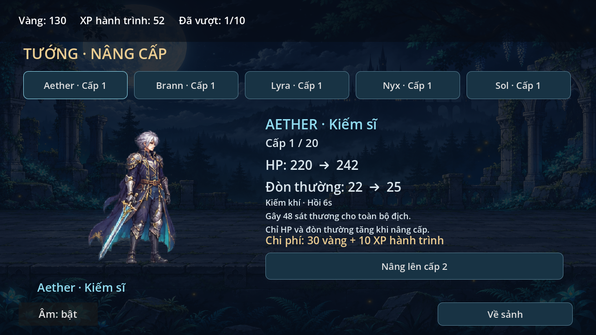
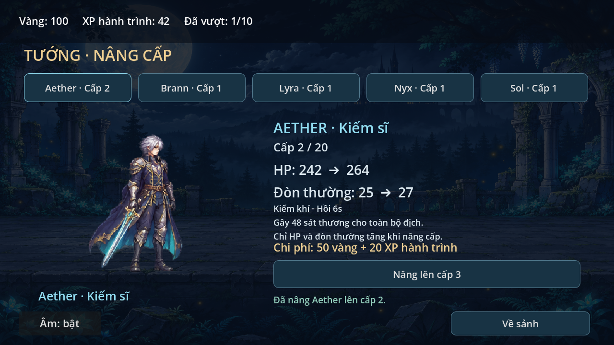
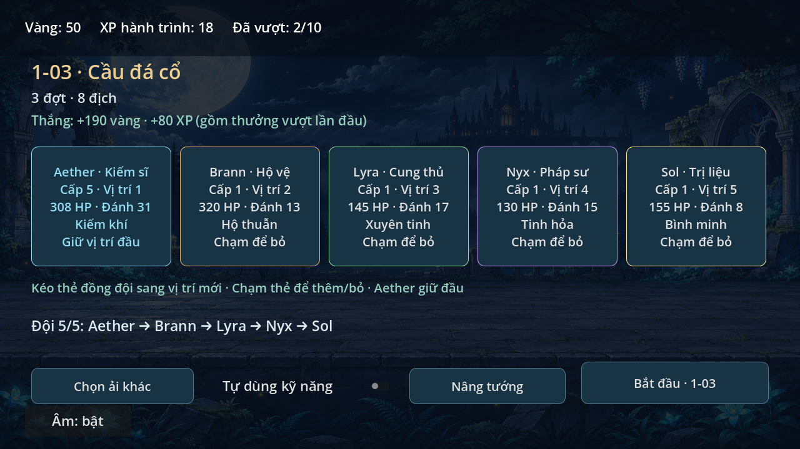
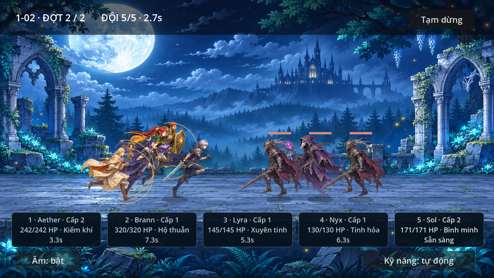

# Nâng tướng — 0.6.0

## Cách chơi
Sảnh → **Nâng tướng**, hoặc nút cùng tên ở màn chuẩn bị đội.
Chọn Aether/Brann/Lyra/Nyx/Sol phía trên để xem cấp, HP, đòn thường, kỹ năng,
chỉ số cấp kế và chi phí. Bấm **Nâng lên cấp…** để nâng một cấp và lưu ngay.
Nút khóa khi thiếu vàng/XP, đạt cấp20 hoặc tiến trình đang khóa. Có dòng báo
thiếu bao nhiêu tài nguyên; nâng thành công có thông báo xanh. Quay lại sảnh
hoặc màn chuẩn bị tương ứng. Cấp mới cũng hiện trên thẻ tướng và HUD trận.

## Thông số thử
Năm tướng bắt đầu cấp1, tối đa20. Mỗi cấp thêm10% **chỉ số gốc** vào HP và
sát thương đòn thường, sau đó làm tròn lên số nguyên. Không nhân nối tiếp
chỉ số đã làm tròn ở cấp trước. Chỉ số nhỏ có thể giữ nguyên qua một bước làm
tròn, nhưng HP vẫn tăng. Kỹ năng, hồi chiêu, tốc độ/tầm đánh không đổi.

Ví dụ Aether:
| Cấp | HP | Đòn thường | Kiếm khí |
| --- | ---: | ---: | ---: |
| 1 | 220 | 22 | 48 |
| 2 | 242 | 25 | 48 |
| 3 | 264 | 27 | 48 |
| 10 | 418 | 42 | 48 |
| 20 | 638 | 64 | 48 |

Để nâng từ cấpL→L+1: vàng =30+20×(L−1), XP =10×L. Cần đủ cả hai loại;
XP hành trình là tài nguyên chung, không phải thanh XP riêng từng tướng.
| Bước | Vàng | XP |
| --- | ---: | ---: |
| 1→2 | 30 | 10 |
| 2→3 | 50 | 20 |
| 3→4 | 70 | 30 |
| 10→11 | 210 | 100 |
| 19→20 | 390 | 190 |

Tổng1→20 cho một tướng là3990vàng+1900XP. Không cho vượt cấp20, không trừ
âm ví, không tự nâng khi nhận thưởng. Bản này chưa có hạ cấp/hoàn tài nguyên.
Các số là thiết kế riêng thử nghiệm, chưa coi là cân bằng cuối.

## Lưu và giữ tiến trình 0.5
Vẫn dùng user://campaign.json, tên project và audio.cfg giữ nguyên.
Schema hiện tại2, thêm hero_levels gồm5cấp theo thứ tự Aether/Brann/Lyra/Nyx/Sol.
Save schema1 từ0.5 được đọc thành schema2 trong bộ nhớ với cả5cấp1, giữ ví,
cleared/records, formation, auto, serial/last_claimed/pending. Không viết lại
file chỉ vì mở game. Hành động ghi thành công tiếp theo mới ghi schema2.

Trước lần ghi thay dữ liệu cũ, giữ nguyên một bản schema1 tại
`campaign.json.v1.bak`, không ghi đè bản này ở lần nâng tiếp. Áp dụng cả khi
phải phục hồi từ backup schema1 do file chính hỏng. `.bak` vẫn luân phiên theo
cơ chế0.5; `.damaged-*` giữ file chính hỏng. Schema tương lai không hỗ trợ bị
khóa ghi; schema2 có cấp sai/thiếu cũng không tự reset đè file.

Cấp và việc trừ vàng/XP cùng một transaction flush/verify/backup/rename.
Nếu lưu lỗi, cả ví/cấp/file chính không thay đổi; nút vẫn có thể thử lại.
Nút nâng kèm cấp dự kiến: callback cũ hoặc bấm trùng không được trừ tiền lần
nữa cho cùng bước. Save2không đọc được bằng bản0.5; bản.v1.bak là trạng thái
trước chuyển đổi, không chứa các nâng cấp/tiến trình mới ở0.6.

## Áp dụng vào trận
PartyData.stats/create tính từ cấu hình gốc và cấp; Progress.hero_stats cung
cấp cùng thông số cho quản lý/chuẩn bị. Khi bắt đầu campaign, main chụp cấp
của5tướng, Battle tạo actor theo ID trong đội đã chọn (không theo slot cố định).
HP mới là HP đầy lúc bắt đầu trận; HP còn lại vẫn giữ qua các đợt như trước.
Đòn thường dùng actor.damage đã nâng; skill power và shield/heal giữ thông số cũ.
Thay cấp lưu không làm thay đổi actor của trận đã bắt đầu. Không có nút nâng
trong trận/pause; chỉ nâng ở sảnh hoặc chuẩn bị. API trận legacy không truyền
cấp vẫn dùng cấp1 cho kiểm tra hồi quy.

## Kiểm tra và giới hạn
- growth_smoke:save1→2 và bản sao nguyên vẹn, dữ liệu cũ giữ, chi phí chính xác,
  thiếu từng loại tài nguyên/đúng đủ, cap20/tổng giá, tướng độc lập, quote cũ,
  lỗi ghi/retry, migration khi recover backup và snapshot battle theoID.
- growth_scene_smoke:đi từ sảnh/prep, chọn5tướng, nâng/thông báo, quay vềprep,
  HUD/chỉ số mới, snapshot không đổi giữa trận, restart giữ cấp/ví/ải,
  lỗi lưu/retry, cap và thiếu tiền qua giao diện.
- Các kiểm tra campaign/save/scene/battle/art/frames trước vẫn chạy riêng save.
- capture_growth:ảnh thực Godot từ fixture schema1 có1ải đã vượt, nâng Aether/
  Sol, đánh1-02 với stat mới; cap/thiếu tiền dùng fixture riêng trong thư mục thử.

Đã xem ảnh render OpenGL Compatibility/Mesa llvmpipe, audio Dummy. Chưa thử
0.6trênS23/Windows thật, cảm ứng/safe area, FPS/nhiệt hoặc nghe âm. Chưa thêm
trang bị, phó bản mới, nhân vật/hình mới, mesh/xương, APK hay dịch vụ online.
