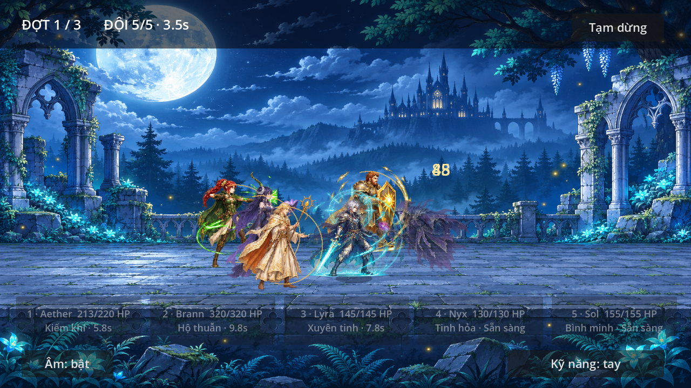
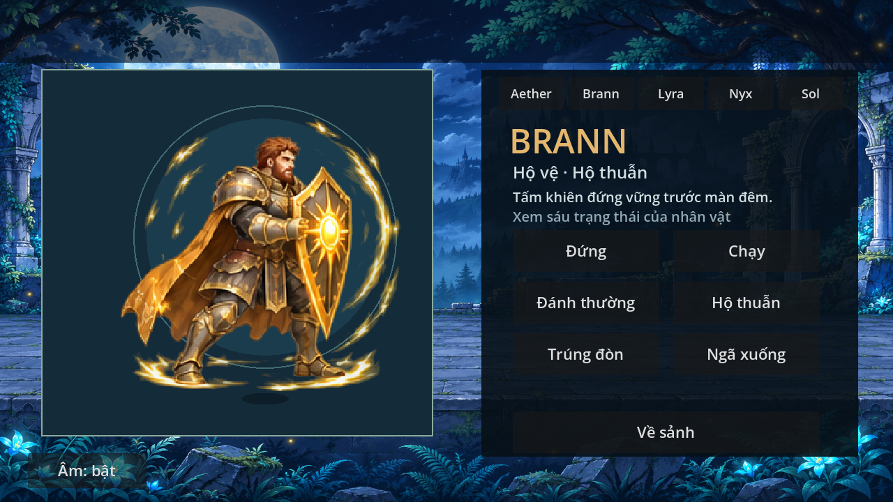
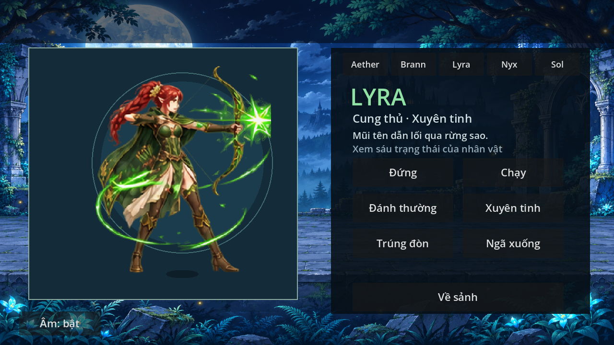
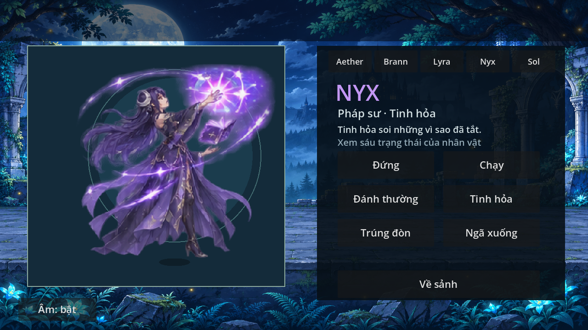
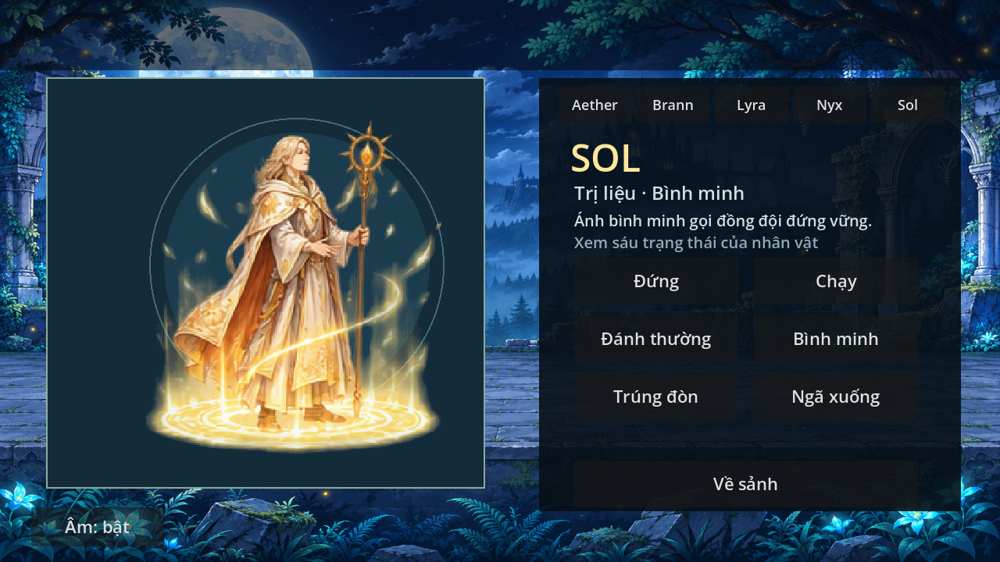

# Bốn đồng đội — 0.4.1

Đã thay toàn bộ hình học tạm trong trận bằng bốn atlas fantasy riêng:
- **Brann**: tóc nâu đỏ/râu ngắn, giáp thép viền vàng, áo choàng hổ phách,
  kiếm ngắn và khiên mặt trời. Kỹ năng tạo vòng hộ thuẫn vàng.
- **Lyra**: cung thủ tai nhọn, tóc đỏ tết, choàng xanh rừng, cung vàng xanh.
  Đánh thường giương/bắn cung; Xuyên tinh là tên sao xanh lục.
- **Nyx**: tóc chàm, áo tím đêm, trăng bạc và sách phép bay.
  Đánh thường phóng tinh hỏa; kỹ năng chòm sao tím.
- **Sol**: tóc vàng nhạt, áo trắng ngà thêu vàng, trượng mặt trời.
  Đánh thường phép vàng, kỹ năng Bình minh có vòng sáng và hạt hồi phục.

## Cách xem/thử
Sảnh → **Xem nhân vật · 5 tướng** → chọn tên phía trên. Mỗi người có sáu nút
đứng/chạy/đánh thường/kỹ năng/trúng đòn/ngã xuống, cùng tên, vai trò và lời mô tả.
Có thể chuyển qua lại Aether và bốn đồng đội mà không vào trận.
Về sảnh → Bắt đầu với đội5 → thử các thẻ kỹ năng, tự động, tạm dừng và chơi lại.
Giữ nguyên chỉ số, sát thương, hộ thuẫn/hồi máu, nhịp trận và audio/save0.4.0.

## Tích hợp
Mỗi atlas RGBA1536×1024 gồm24ô256², cùng layout với Aether: đứng6/chạy6/
đánh6/kỹ năng3/hurt1/death2. `HeroArt` dùng texture cấu hình được; giữ mặc định
Aether. `CompanionArt` dùng chung renderer nhưng tắt vòng/chém xanh của kiếm sĩ,
chọn sheet theo ID và đồng bộ actor thật. Ba pose kỹ năng Lyra có khoảng cách
khác lưới đều nên dùng source region riêng (ghi trong manifest), tránh lộ pose kế bên. Không dùng đồng đội đổi màu Aether.
Nhịp chuẩn bị đòn và nghỉ được ánh xạ vào sáu frame đánh; kỹ năng hiện tức thì
về logic như trước. Hurt theo HP giảm, death cả khi đó là tướng cuối bị hạ;
pause dừng clock. Hiệu ứng hộ thuẫn tồn tại theo shield actor.
Vị trí hình có độ lệch nhỏ và tầng đứng để tách silhouette, không đổi tầm đánh.

## Nguồn và giới hạn
Nguồn: OpenAI image generation trong phiên ngày2026-11-06. Brann/Lyra được
sửa alpha bằng image generation sau khi phát hiện nền mờ trong render thật.
PNG đầu ra được chép nguyên vẹn; không cắt nền bằng code. Shader lọc alpha0.3.2
vẫn dùng khi render. SHA256/nguồn/layout trong `assets/party/manifest.json`.
Không dùng nhân vật, hình, code hoặc âm của game khác; không thêm API runtime,
phí, dịch vụ hoặc nhạc mới. Không gán nhãn vẽ tay/CC0.

Đã xem atlas và ảnh render thực bằng Godot4.6.3/OpenGL Compatibility/Mesa
llvmpipe, audio Dummy. Đây là hoạt ảnh từ atlas sinh bằng AI, có thể dao động
chi tiết hoặc tỷ lệ giữa frame; hurt1pose, death2pose, không phải bộ hoạt ảnh
thủ công nhiều in-between. Chưa duyệt trên S23 Ultra, nghe âm, đo FPS/nhiệt
hoặc xác nhận cảm ứng máy thật. Cần người dùng duyệt mỹ thuật trên thiết bị.
