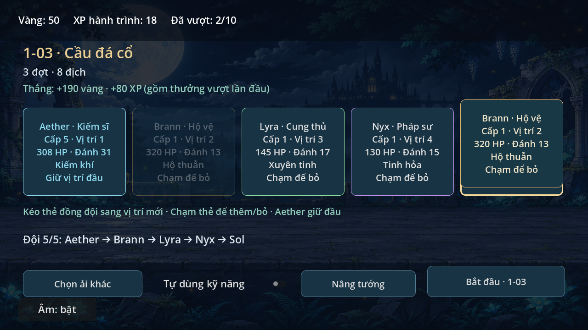
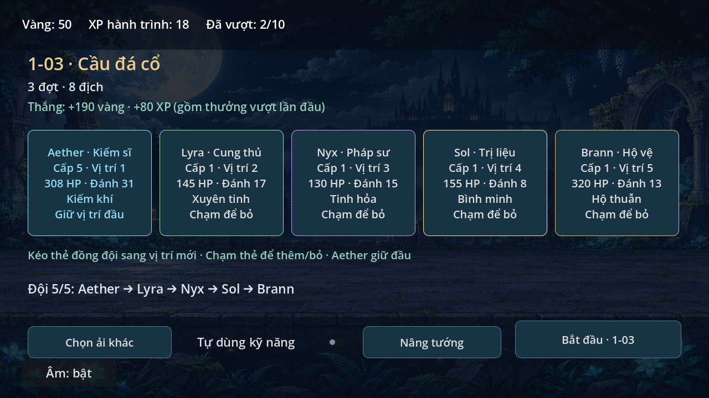

# Kéo thả đội hình · 0.6.1

Trong màn chuẩn bị, giữ và kéo thẻ một đồng đội đã chọn sang thẻ đồng đội khác.
Viền vàng đánh dấu vị trí thả; thả tay để chèn tướng vào vị trí đó và lưu ngay.
Các thẻ còn lại dịch vị trí tương ứng. Dùng chuột trái hoặc một ngón tay.

Chạm nhanh vẫn thêm/bỏ đồng đội. Aether cố định ở đầu; tướng dự bị chỉ thêm
bằng chạm. Thả ra ngoài, lên Aether hoặc về chính thẻ đang kéo sẽ hủy đổi thứ tự.
Mất focus, Escape hoặc hệ điều hành hủy cảm ứng cũng hủy thao tác.

`game/party_drag.gd` xử lý ngưỡng kéo, hình xem trước, tọa độ canvas và một
pointer duy nhất. Mouse tổng hợp từ touch không gây chạm hai lần. Đổi thứ tự
qua `reorder_companion` và transaction lưu hiện có; lỗi ghi giữ nguyên đội.
Save schema2, cấp tướng, vàng/XP và tài nguyên hình giữ nguyên.

Kiểm tra bằng `godot --headless --path . --script tests/party_drag_smoke.gd`
với XDG_DATA_HOME riêng. Test gửi sự kiện viewport thật cho chuột/native touch,
mouse tổng hợp, nhiều ngón, hủy, canvas thu phóng, lỗi ghi/reload và đội vào trận.
Ảnh chụp từ Godot4.6.3/OpenGL Compatibility/Mesa llvmpipe trên Linux,
âm thanh Dummy. Chưa kiểm tra trực tiếp thao tác trên S23 Ultra.
