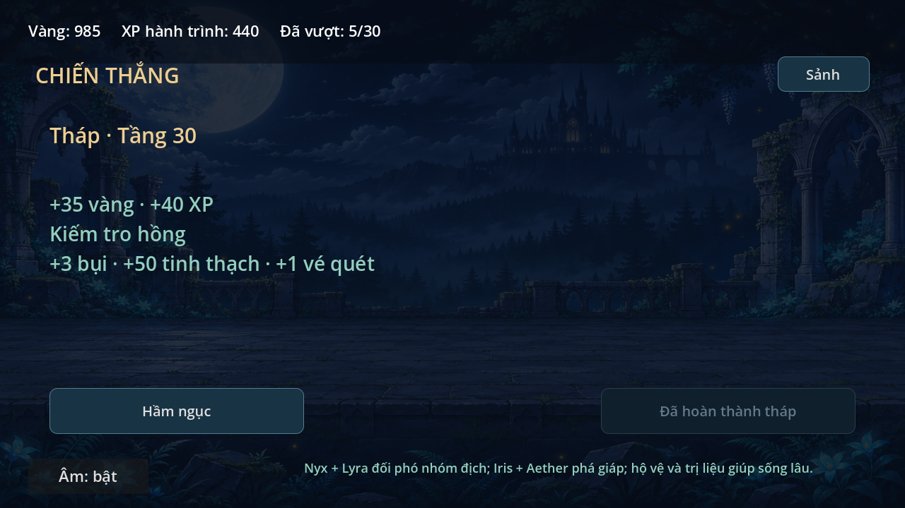
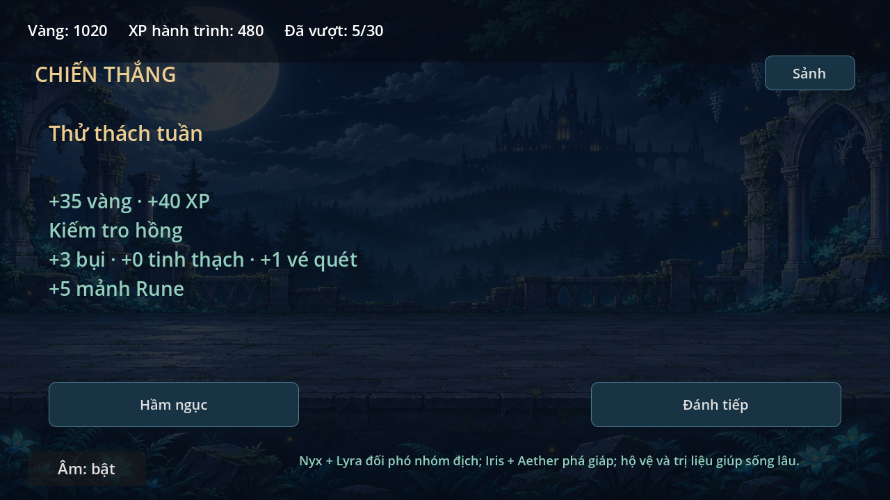

# Báo cáo rà soát RPG — 0.8.1, 06/11/2026

Đọc AGENTS/README/HANDOFF, kiểm Git/PR và xác nhận main ở89c92f2 trước khi sửa.
PR mở rộng0.8.0 đã merged. Chỉ có UID test sinh sẵn chưa track trong workspace;
không ghi đè chúng. Không có PR mở khác trong kết quả truy vấn lúc kiểm.

| Phần kế hoạch | Trạng thái đã kiểm tra |
| --- | --- |
| Sảnh/quản lý tướng | Có sảnh và mục tiêu, tám tướng/năm slot, cấp/kỹ năng/bậc, trận thử |
| Săn đồ/túi/cường hóa | UID riêng, đồ theo chương, bộ, mặc/tháo, nâng/phân giải, kho tối đa500 |
| Nội tại/phối hợp/địch | Có phá giáp/burn/hỗ trợ, địch giáp/hồi máu/sát thủ, boss biến thể |
| Chương/hầm/tháp/quét | 30ải, hai hầm tài nguyên, tháp30, vé quét riêng và điều kiện ba thắng |
| Triệu hồi/mảnh | Có tỉ lệ, lượt1/10, mong muốn/bảo đảm20, mảnh mở tướng/nâng bậc |
| Mục tiêu/tuần/luân phiên | Sáu mục tiêu, thưởng thắng tuần, nhóm địch và mảnh luân phiên |
| Thống kê local | Có lượt bắt đầu/thua theoải, ngày hoạt động và bộ đếm; không gửi mạng |

Đây là đầy đủ luồng bản thử, không có hệ thống cốt lõi nào trong bảng bị bỏ trống.
Không coi sự tồn tại tính năng hoặc test mô phỏng là bằng chứng giữ chân.

## Lỗi tìm được và đã sửa
1. Màn thưởng hầm chỉ hiện vàng/XP/đồ, thiếu tài nguyên đã cộng. Receipt và UI nay
   hiện đủ bụi, tinh thạch, mảnh đúng tướng và vé quét, gồm chuyển đồ khi kho đầy.
2. Trận thử thách qua tuần có thể lấy mảnh theo tuần kết thúc. Pending nay giữ
   vòng tuần bắt đầu cho cả địch và mảnh; save4 cũ thiếu metadata vẫn đọc được.
3. Tầng30 vẫn có nút đánh tiếp dẫn tới lỗi chung. Nay hiển thị đã hoàn thành và khóa.
4. Về sảnh/chọnải có thể rời trận dù lưu bỏ trận thất bại; auto cũng đổi trước
   khi lưu. Nay giữ màn/trận/cờ auto cũ và báo lỗi để thử lại.
5. Thanh HP/nhãn địch cũ còn hiện mờ sau màn kết quả. Nay chỉ vẽ ởtrận/pause.

## Bằng chứng
23/23 smoke PASS trên Godot4.6.3 headless, save/config/cache riêng trong /tmp.
Test mới rpg_review_smoke kiểm các trường hợp1–4, tính tương thích pending cũ và
validation snapshot. Giữ22 kiểm tra trước về save/loot/pity/tactics/scene/art/audio.
Hai ảnh Godot OpenGL/Mesa từ fixture giả lập thắng để duyệt màn thưởng:

## Chưa hoàn thành hoặc chưa kiểm chứng
- Hình độc lập cho Iris/Rune/Vera và các chương/quái/boss mới; hiện dùng biến thể
  của tài nguyên riêng cũ. Không dùng asset từ ảnh tham khảo.
- Chơi thực trên S23, cảm ứng thật, nghe âm và đo FPS/nhiệt thiết bị.
- Cân bằng và giữ chân với người chơi thật; thống kê local chưa có cohort cộng đồng.
- APK, PvP, bang hội/server hoặc shop nạp không nằm trong bản thử đã chốt.

Không phát sinh API trả phí hoặc dịch vụ runtime trong lượt rà này.
