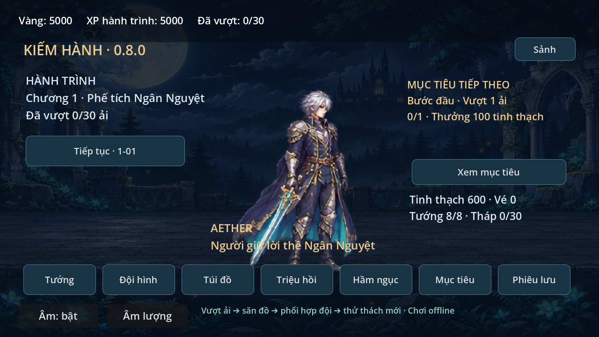
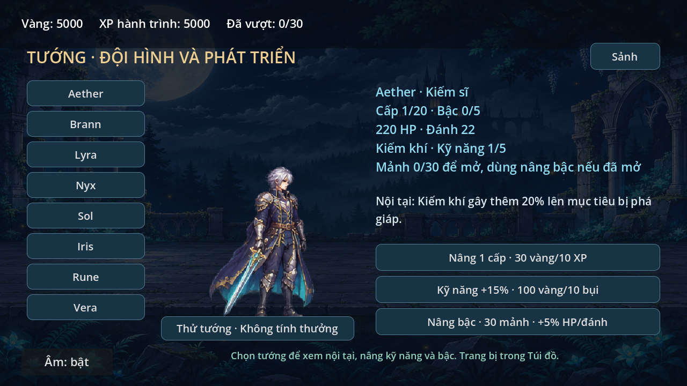
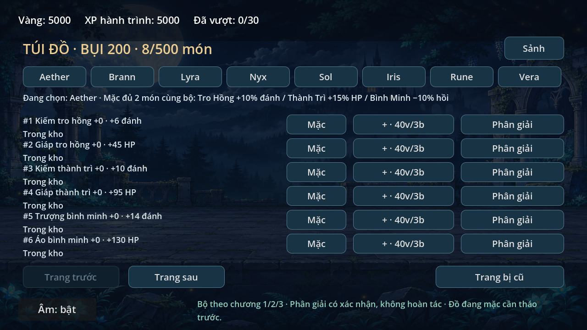
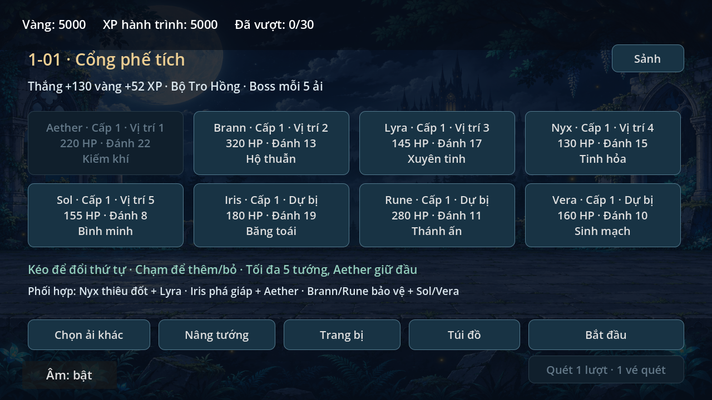
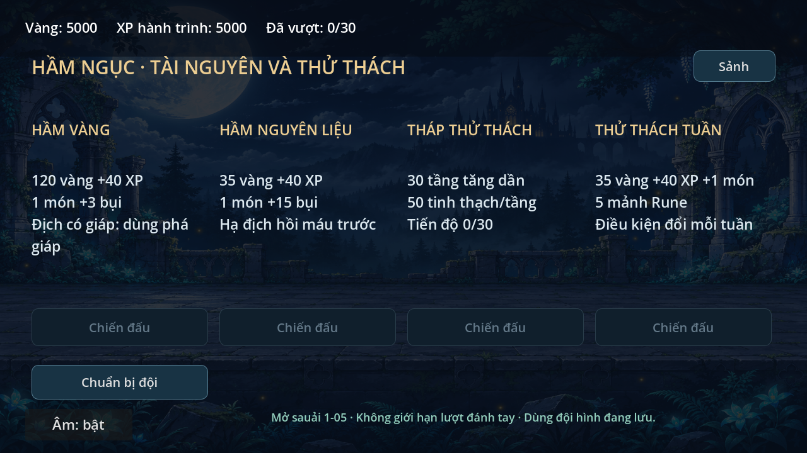
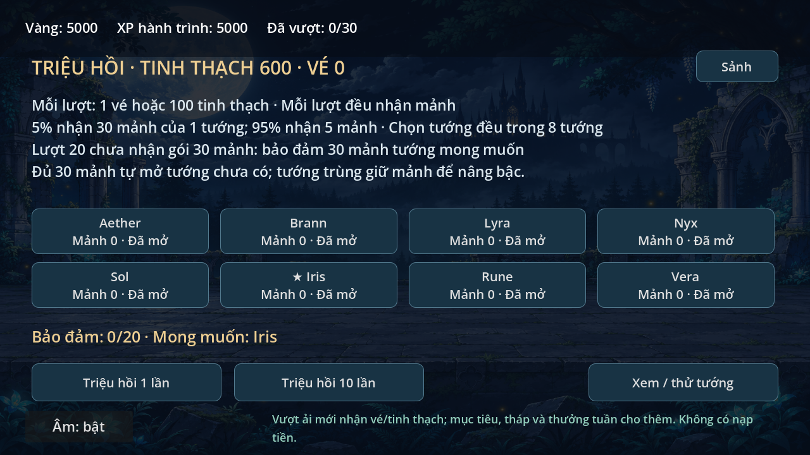

# Kiếm Hành 0.8.0 — vòng chơi và tiến trình offline

Sảnh → Phiêu lưu → chuẩn bị đội → chiến đấu → nhận đồ → nâng đội → thử thách mới.
Mọi tài nguyên kiếm qua chơi. Ảnh tham khảo dùng định hướng chức năng;
không sao chép hình, nhân vật hoặc mã nguồn của game tham khảo.

## Sảnh và tướng
Sảnh có nhân vật đại diện, mục tiêu tiếp theo và bảy cửa: Tướng, Đội hình,
Túi đồ, Triệu hồi, Hầm ngục, Mục tiêu, Phiêu lưu. Tiếp tục vào ải đang mở.
Mục tiêu chưa đủ có nút Đi tới; đủ điều kiện có nút Nhận, chỉ nhận một lần.

Tướng hiện cấp, HP, đòn thường, kỹ năng, nội tại, mảnh và bậc. Nâng cấp 1–20
vẫn dùng giá cũ. Kỹ năng 1–5: mỗi bước thêm 15% power gốc; giá 100×L vàng và
10×L bụi. Bậc 0–5: mỗi bậc thêm 5% HP/đánh, giá 30×(bậc+1) mảnh đúng tướng.
Thử tướng mở trận luyện cả khi chưa sở hữu, không ghi thưởng hoặc tiến trình.

Giữ năm tướng cũ. Iris/Rune/Vera cần 30 mảnh để mở. Đội tối đa năm người,
Aether giữ đầu; kéo thả trên hai hàng tám thẻ, không thêm tướng chưa mở.
Ba tướng mới dùng hình biến thể nhuộm màu Nyx/Brann/Sol từ tài nguyên riêng
sẵn có. Có tên, vai trò và cơ chế riêng, **chưa có hình độc lập**.

## Săn đồ và túi đồ
Mỗi trận thắng nhận một món có UID riêng. Đồ luân phiên theo số lần thắng ải,
cho phép kiếm đủ cặp với tiến độ xác định. Mỗi chương có một bộ gồm hai món:

| Bộ / nơi kiếm | Vũ khí | Giáp | Đủ hai món |
| --- | ---: | ---: | --- |
| Tro Hồng / chương I | +6 đánh | +45 HP | +10% đánh |
| Thành Trì / chương II | +10 đánh | +95 HP | +15% HP |
| Bình Minh / chương III | +14 đánh | +130 HP | −10% hồi kỹ năng |

Túi phân trang sáu món, tối đa 500. Hiện chỉ số và người đang mặc; có nút mặc,
tháo, cường hóa và phân giải. Phân giải cần xác nhận, chỉ áp dụng món chưa mặc,
trả 5+3×rank bụi. Cường hóa +0→+10, mỗi bước cộng 15% chỉ số gốc của món;
giá 40×(rank+1) vàng và 3×(rank+1) bụi. Khi kho đầy, đồ rơi đổi thành 5 bụi.

Giữ hai ô vũ khí/giáp. Thay đồ trả món trước về kho. Đồ cũ 0.6.2 còn ở
Trang bị cũ, không mất sở hữu. Mặc món mới tháo món cũ cùng ô và ngược lại,
không cộng hai lần cùng ô. Bonus đồ cộng sau cấp, bậc nhân HP/đánh rồi áp bộ.
Trận chụp thông số theo ID, không đổi theo dữ liệu lưu sửa sau khi đã bắt đầu.
Chưa có affix ngẫu nhiên, bán, khóa món hoặc nhiều loại ô khác.

## Chiến đấu và 30 ải
Chương I giữ 10 ải gốc; chương II/III có 10 ải mỗi chương với địch mới:
- Giáp: giảm 35% sát thương khi chưa bị phá giáp.
- Hồi máu: hồi 8% HP tối đa cho địch sống mỗi 4 giây.
- Sát thủ: tìm tướng phía sau; chốt mục tiêu từ lúc chuẩn bị đến khi ra đòn.

Tên loại và màu phân biệt trong trận. Boss mỗi năm ải: Nguyệt Thực giữ bộ đòn
cũ; Tro Hồng có đòn toàn đội; Bình Minh truy kích tuyến sau và đánh toàn đội.
Có báo tên/chuẩn bị, không thêm cửa sổ sơ hở hoặc canh thời điểm để nhân sát thương.
Cảnh dùng nền cũ đổi sắc theo chương; hình quái/boss vẫn từ bộ riêng sẵn có.

| Tướng | Nội tại khi bật tactics |
| --- | --- |
| Aether | Kiếm khí thêm 20% lên địch bị phá giáp |
| Brann | Dưới 50% HP nhận giảm 20% sát thương |
| Lyra | Đánh thường thêm 15% lên địch thiêu đốt |
| Nyx | Kỹ năng thiêu đốt 3 giây, 4 sát thương mỗi 0.5 giây |
| Sol | Kỹ năng giảm 20% hồi chiêu còn lại của đồng đội sống |
| Iris | Kỹ năng phá giáp mục tiêu 6 giây trước khi gây sát thương |
| Rune | Hộ thuẫn hồi thêm 20 HP cho đồng đội sống |
| Vera | Đánh thường hồi 4 HP cho đồng đội sống có tỉ lệ HP thấp nhất |

Campaign, hầm và trận thử bật tactics. API trận legacy giữ hành vi cũ cho hồi quy.

## Hầm, tháp và quét
Vượt 1-05 mở bốn chế độ, dùng đội đang lưu:

| Chế độ | Thưởng thắng | Đặc điểm |
| --- | --- | --- |
| Hầm vàng | 120 vàng, 40 XP, một đồ, 3 bụi | Địch có giáp |
| Hầm nguyên liệu | 35 vàng, 40 XP, một đồ, 15 bụi | Có địch hồi máu |
| Tháp | 35 vàng, 40 XP, một đồ, 3 bụi, 50 tinh thạch | 30 tầng mở tuần tự, nhận thưởng tầng một lần |
| Thử thách tuần | 35 vàng, 40 XP, một đồ, 3 bụi, 5 mảnh tướng | Ba nhóm địch và tướng thưởng xoay theo tuần |

Đánh tay không giới hạn. Mỗi trận thắng cho một vé quét; khởi đầu có năm vé.
Quét cần thắng ải ba lần và một vé/lượt, nhận thưởng chơi lại, đồ, 2 bụi.
Không nhận lại thưởng đầu hoặc tính vào thắng tuần. UI quét một lượt;
API cho 1–10 lượt. Vé quét tách vé triệu hồi; chưa quét hầm/tháp.

## Triệu hồi
Một lượt dùng một vé trước, thiếu vé dùng 100 tinh thạch/lượt. Có nút 1/10 lượt.
95% nhận 5 mảnh, 5% nhận 30 mảnh; chọn đều tám tướng ngoài lượt bảo đảm.
Nếu 19 lượt chưa nhận gói 30 mảnh, lượt 20 bảo đảm 30 mảnh tướng mong muốn.
Nhận gói 30 mảnh reset pity; đổi mong muốn không reset. Đủ 30 mảnh tự mở tướng
chưa có; tướng trùng giữ mảnh để nâng bậc. Mảnh kiếm từ nơi khác có nút Mở tướng.

Khởi đầu có 600 tinh thạch. Mỗi ải lần đầu thêm 100 và một vé triệu hồi;
tháp, mục tiêu và thưởng tuần cho thêm. Tỉ lệ hiện trên màn hình.
Kết quả, vé, tinh thạch, pity, mảnh và quyền sở hữu cùng một transaction.
Không có dịch vụ, mạng hoặc tiền thật trong triệu hồi này.

## Mục tiêu và thống kê
Sáu mục tiêu một lần: vượt 1/5/10/20 ải, cường hóa ba lần, triệu hồi mười lần.
Thưởng vàng/tinh thạch hiện trước. Thắng mười trận đánh tay trong tuần nhận
300 tinh thạch và ba vé triệu hồi một lần. Tuần theo UTC thứ Hai; tuần mới chỉ
reset mục tiêu tuần, không phạt bỏ đăng nhập. Dùng đồng hồ máy, không có chống
gian lận thời gian như game có server.

Mục tiêu → Thống kê local: ngày có hành động lưu, lượt bắt đầu/thua theo ải,
trận/thắng, nâng tướng, cường hóa, triệu hồi và quét. Không gửi dữ liệu ra mạng.
Đây chưa phải đo cohort/toàn cộng đồng hoặc bằng chứng giữ chân; cần người chơi
thật để kiểm chứng nhịp mở tính năng, độ khó và phần thưởng.

## Save và kiểm tra
Schema 4 thêm rpg, giữ năm cấp cũ và ba cấp tướng mới riêng. Đọc schema 1/2/3
không ghi ngay; lần commit thành công giữ bản .v1.bak/.v2.bak/.v3.bak theo nguồn,
kể cả recover. Giữ cơ chế tmp/flush/verify/backup/rename và khóa schema tương lai.
UID và số JSON chuẩn hóa về int. Validation kiểm ô, trùng món, giới hạn kho,
cấp, pity, tầng và các mảng. Không reset đè save hỏng. Hầm dùng run token chung,
retry không cộng lại thưởng; lỗi ghi không đổi ví, đồ, mảnh hoặc sở hữu.
Bản game cũ không đọc được save 4; backup migration là trạng thái trước chuyển đổi.

Ba test mới: rpg_progress_smoke, rpg_scene_smoke, rpg_tactics_smoke. Giữ 19 test
hồi quy cũ; xem TEST_RESULTS.md cho kết quả cuối. Capture tám màn bằng Godot
OpenGL/Mesa, profile thử riêng, đã xem ảnh sảnh/tướng/túi/triệu hồi/chuẩn bị.
Chưa thử S23, cảm ứng thật, nghe âm, đo FPS/nhiệt hoặc kiểm chứng giữ chân.
Chưa có hình độc lập cho tướng/chương mới, APK, bang hội, PvP, shop nạp hay server.
