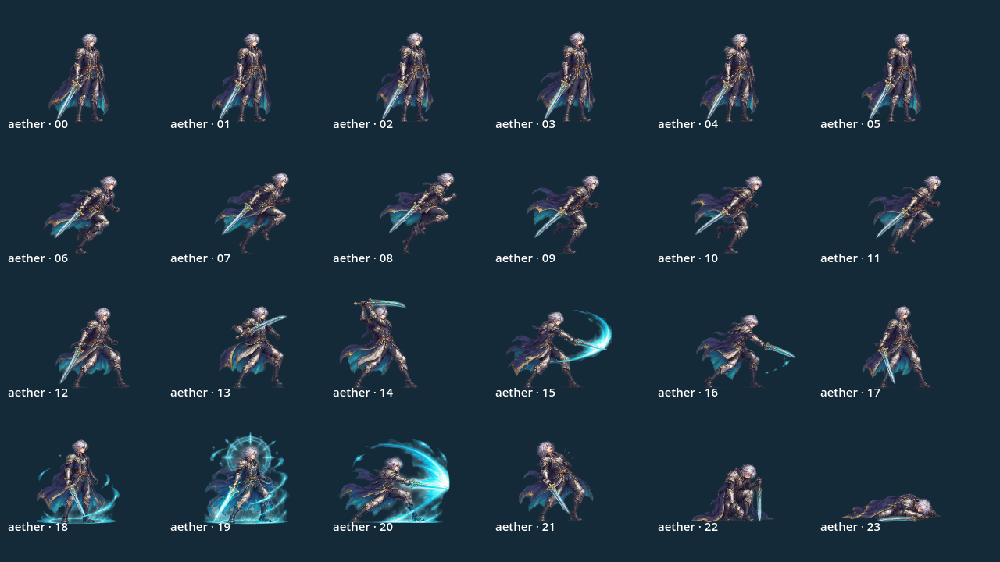
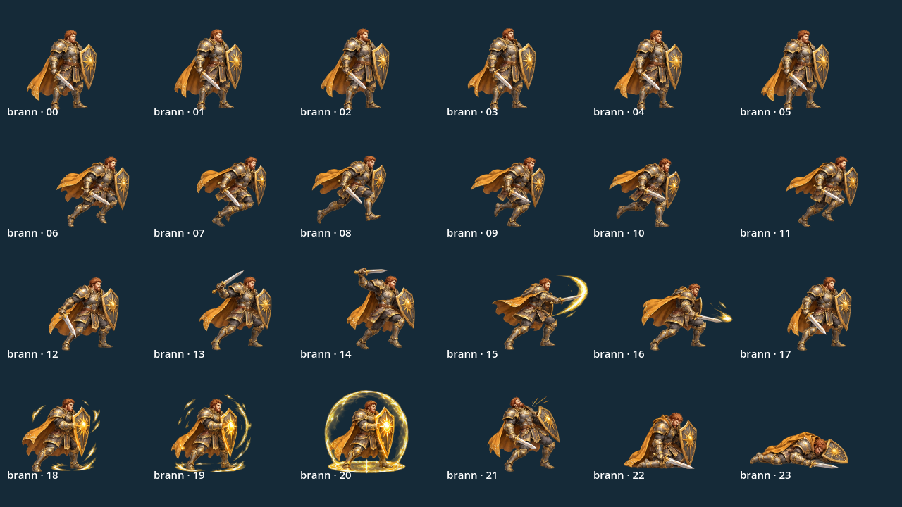
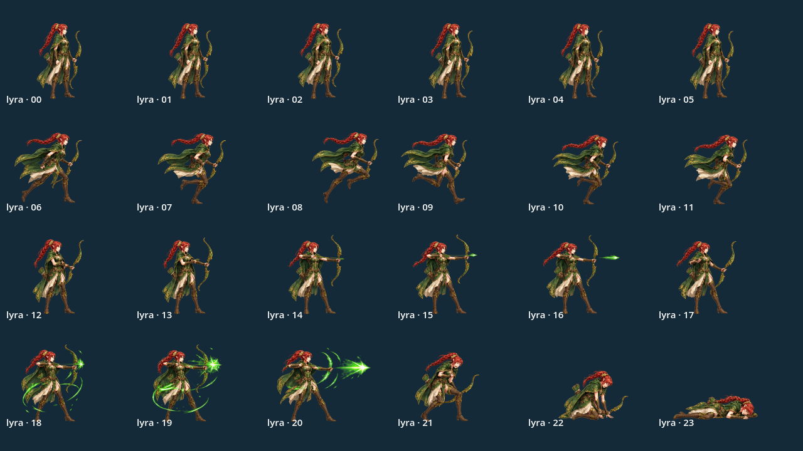
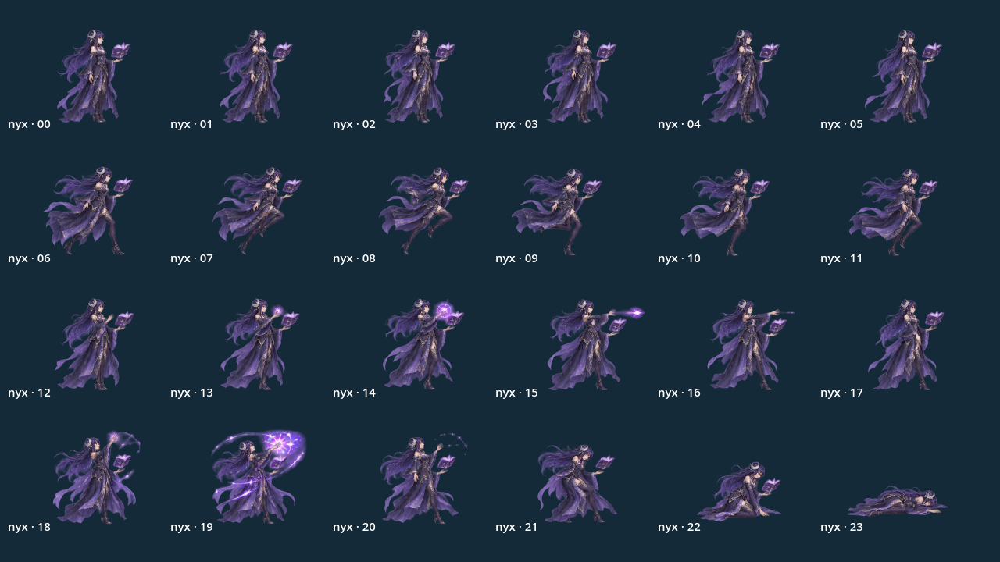
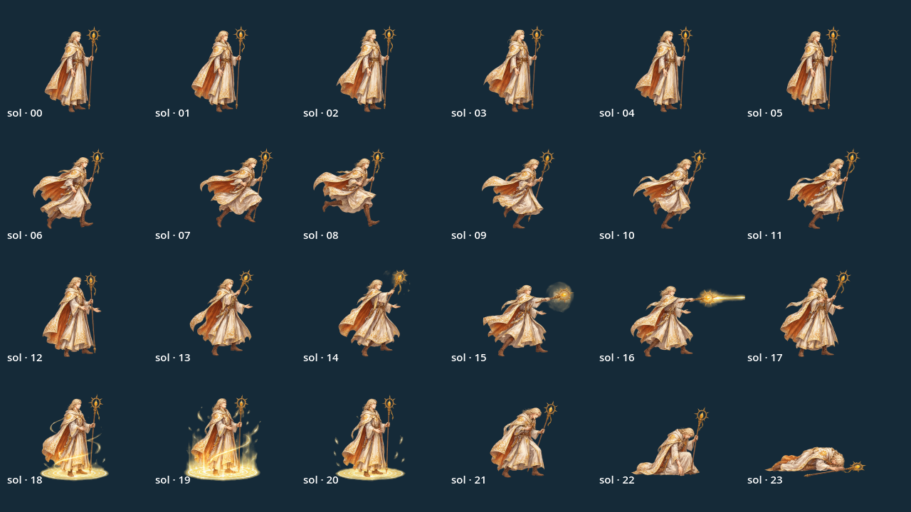
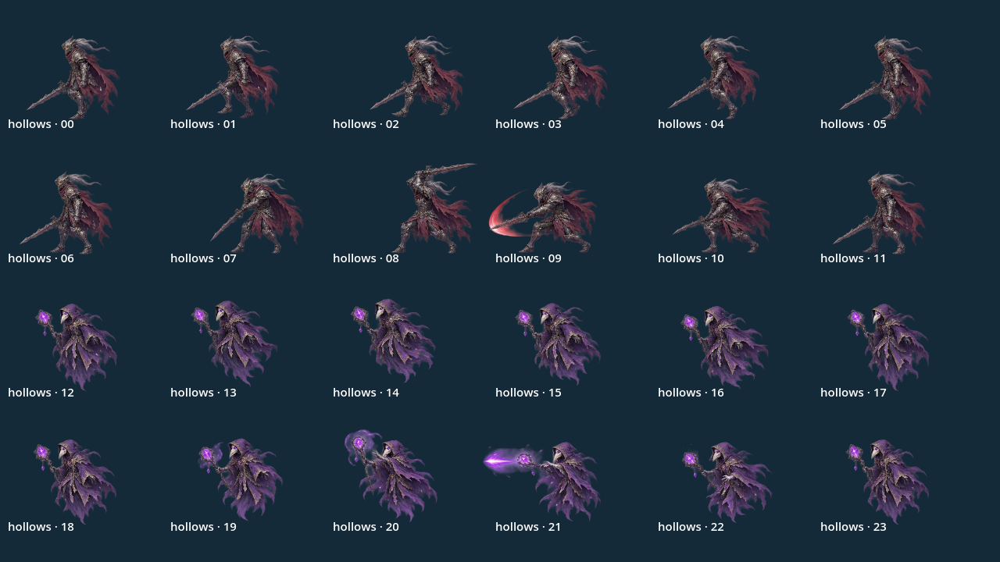
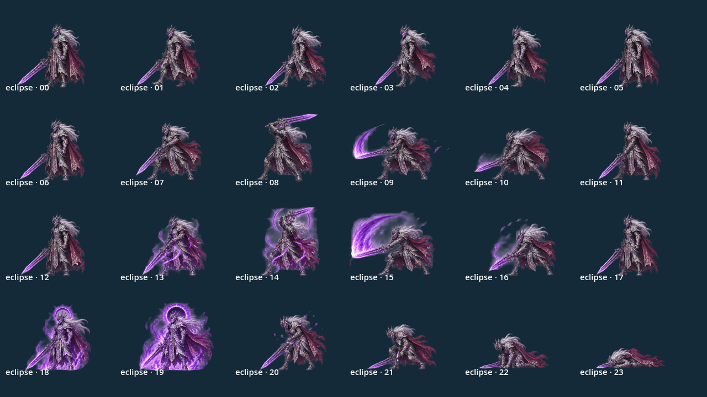

# PNG từng frame — 0.4.3

Đã gỡ bản thử bộ xương theo phản hồi. Game giữ hình và cách chơi cũ, đổi cách
cấp hình cho renderer: mỗi tư thế là một PNG riêng, không lấy ô từ sheet nữa.

## Cách thử
Sảnh → **Xem nhân vật · 5 tướng** → chọn tướng và trạng thái. **Frame trước** /
**Frame sau** dừng ở một hình, số frame hiện bên phải. **Phát lại** khởi động
lại hoạt ảnh; đổi tướng/trạng thái cũng trở về phát bình thường. Bước frame có
quay vòng và hoạt động với cả sáu trạng thái của năm tướng.
Trong trận, thử đánh/kỹ năng, tạm dừng, qua đợt, boss, chơi lại như trước.
Không cần cài thêm thư viện trên điện thoại, không có APK hoặc dịch vụ mới.

## File và điểm neo
`assets/frames/` có bảy bộ: aether, brann, lyra, nyx, sol, hollows và eclipse.
Mỗi bộ24PNG (`00.png`–`23.png`), một `frames.tres` và `manifest.json`: tổng168PNG.
Hollows chứa hai loại quái, mỗi loại hai hàng đi/đánh như trước. Thứ tự clip
cũ giữ nguyên; riêng tướng vẫn đứng6/chạy6/đánh6/skill3/hurt1/death2.

PNG được trim rồi thêm8pixel alpha0 mọi phía, không resize hình gốc. Điểm neo
chân của mỗi pose được ghi riêng; metadata draw_offsets trong SpriteFrames
đặt PNG vào vị trí tương ứng. Canvas lớn chỉ dùng lúc xử lý/audit, không đưa
cả vùng trong suốt512px vào từng texture runtime để tiết kiệm bộ nhớ.
`game/sprite_frames.gd` tham chiếu tường minh các bank để Godot export đủ PNG.
HeroArt/CompanionArt/EnemyArt/BossArt chỉ gọi draw_texture trên PNG đã chọn;
không có AtlasTexture, chia cột/hàng hay source rectangle trong renderer.

## Cách tách và nguồn
`tools/split_sprite_frames.py` phân tích alpha của sheet gốc thành các silhouette
2D hoàn chỉnh, kể cả phần vượt ranh giới hàng/cột. Không chỉ crop168ô256².
Giữ component thân nguyên vẹn, ghép sách/phụ kiện/particle rời theo silhouette;
review và gán riêng tên thường/tên skill Lyra cho pose bắn, tránh dính pose nghỉ
hoặc trúng đòn kế bên. Bỏ residue alpha<=20/255 và đảo pixel rất nhỏ ở xa hình;
shader alpha0.3.2 tiếp tục áp dụng một lần khi render, giữ modulation/fade.
Hai pose phép boss có glow liền nhau: tách tại seam x740 đã duyệt giữa hai thân,
fade alpha riêng ánh sáng tím trong12pixel sát seam để tránh mép sáng cứng;
không đổi pixel giáp/áo. Particle phục hồi của Nyx gán về pose skill20.

Manifest ghi SHA256 ảnh nguồn, anchor nguồn, số pixel, kích thước và offset
mỗi frame. Script dev cần Pillow/numpy/scipy; runtime chỉ cần PNG và tres đã có.
Các sheet gốc giữ nguyên để đối chiếu, không được load làm sprite trong trận.
Đây là xử lý các asset gốc sinh bằng OpenAI image generation trong dự án;
không thêm asset game khác, API runtime, dịch vụ hoặc âm thanh.

## Giới hạn
Cách này loại bỏ việc lấy nhầm vùng ảnh kế bên khi phát frame. Nó không tự vẽ
lại chi tiết đã biến dạng/mất ngay trong ảnh AI nguồn, không tạo thêm in-between.
Vùng glow của boss vốn dính nhau phải chia giữa hai pose, không thể khôi phục
một lớp hình đã che nhau trong ảnh phẳng. Cần duyệt lại nhịp hình trên S23;
chưa đo FPS/nhiệt/cảm ứng hoặc nghe âm. Chỉ số và logic sát thương không đổi.

## Ảnh kiểm tra từ Godot
Các ảnh dưới render toàn bộ24PNG của từng bank bằng renderer thật, không phải
ảnh sheet nguồn. Có thêm ảnh trận/viewer trong PARTY_ART.md.

## Kiểm tra
frame_assets_smoke kiểm168texture độc lập, padding, offset khớp manifest,
đầu cung/halo vượt hàng được giữ và viewer bước đủ frame/đóng băng/quay vòng.
alpha_render kiểm168frame trong OpenGL: cạnh trong suốt trùng nền, không bleed
texture kế bên. Các smoke test logic trận/scene/nhân vật/đội hình tiếp tục chạy
với save directory riêng. capture_frames và capture_party tạo ảnh render thật.
